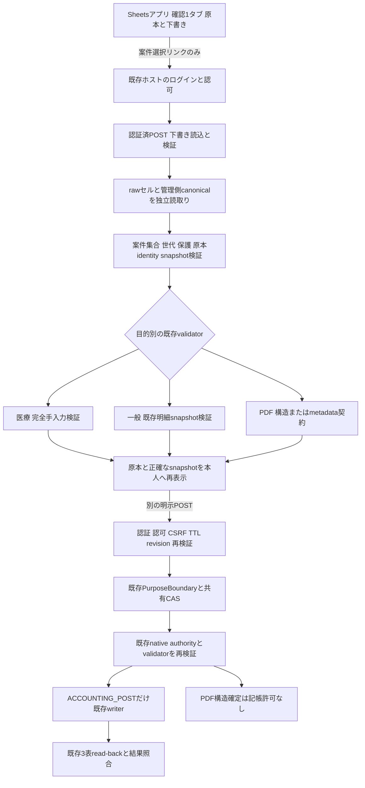

# 1タブ下書きUIから既存確認処理への接続契約（Phase 3）

2026-10-17。**設計＋完全合成read-only／dry-run。実ホスト・Sheets・実OAuthへ未接続**。Phase 1は[PR #126](https://github.com/tmoriuchi1401-source/kakeibo-ai/pull/126)、main merge `d62e1e2`。処理コードは独立ブランチ `codex/iphone-one-tab-safety`、[Draft PR #127](https://github.com/tmoriuchi1401-source/kakeibo-ai/pull/127)。依存する[Draft #123](https://github.com/tmoriuchi1401-source/kakeibo-ai/pull/123) `1db04ac`／[Draft #124](https://github.com/tmoriuchi1401-source/kakeibo-ai/pull/124) `936388f`は変更しない。

## 1. 推奨データフロー

図の実ホスト・確定要求部分は**接続設計**。今回追加したコードはCとVのオフライン契約のみ。Sheets編集／状態選択には実行先がなく、既存定期処理は「確認」タブを読まない。GETは保存済み表示を読むだけで、capture、観測／proposal更新、authority、CAS、記帳を呼ばない。下書き読込は明示的な認証済POSTとして設計し、その成功も確定要求にしない。

確定画面は案件ID・原本リンク／ページ・全明細・旧値と提案値・保留理由・purposeを表示し、ユーザーが原本と照合する。値のみの部分ソートは意図的手修正と区別できないため、この再確認を省略しない。確定時のsnapshotが変われば再確認。URLやログに入力値・医療情報を載せない。

## 2. 再利用できるコードと不足機能

| 既存コード | 再利用範囲／注意 | 今回の証拠・不足 |
|---|---|---|
| `app/receipt_confirmation.py`：`review_id`／`ui_rows` | 原本ID/version/hashによるID、重複ID・見出し検証。行番号は一時位置 | 旧「領収書確認」schema。1タブのraw readerは未実装 |
| 同：`_parsed`／`_plan` | 医療の完全手入力、日付・実支払額・カテゴリ、既存3表・重複候補照合 | `ReceiptConfirmationPort.validate_draft`経由で実validatorを実行。AIなし |
| 同：`apply_confirmations`／`_write_accounting_plan`／`_complete` | durable pending intent、反映直前検証、ID別既存writer、3表read-back、応答不明時の再追加防止 | 今回は呼ばない。旧セル判断を取込時に処理する経路があるため、新タブを直接差し替えてはならない |
| `app/receipt_item_review.py`：`card`／`check_snapshot`／`snapshot`／`evaluate`、`receipt_item_confirmation` | 一般の明細ID・金額・カテゴリ・構造・本人確認snapshot | 実装をそのままdry-run。領収書単位カテゴリを全明細に配らない。単一行から複数明細へ入力するUI契約は不足 |
| `app/pdf_intake_runner.py`：`PageIntake.post_manual(apply=False)`／`exact_readback`／`ScopedWriter` | 既存Unit、posting authority、本人proof、duplicate、CAS intent、許可されたmaterializerと読戻し | 既存回帰テストで再利用。今回新しい金融write経路は追加しない |
| `app/receipt_plan/unit_posting.py` | 独立承認済みの範囲限定Unit writer、revision・read-back・replay | 既存限定canary許可を新しい原本へ流用しない |
| PR #123：`unified_receipt_review`／`unified_receipt_eligibility` | read-only統合projection、原本/page/Unit/indexの整合、旧医療隔離、複数operation owner拒否 | H301隔離、G103保留を維持。合成入力から本番適格性やauthorityを作らない |
| PR #124：`unified_receipt_native.ReceiptConfirmationPort` | 医療等のnative検証、既存writerへの限定adapter、legacyとの共有gate | 今回医療dry-runを再利用。全legacy instanceへのgate配線は未接続 |
| PR #124：`unified_receipt_purposes` | STRUCTURE／METADATA／RECONCILIATION／ACCOUNTINGの契約分離、native evidence検証、owner/session/CSRF/TTL | PDF構造の純粋`validate_observation`を再利用。構造確定→会計許可への昇格禁止 |
| PR #124：`ConditionalRequests`／`UnifiedWriteBridge` | 同一native operation、request conflict、strong ETag CAS、revision、read-back、replay／unknown停止 | 新規の受付ストアを別に作らず共用する設計。SheetにCASがあるとは仮定しない |
| `auth-session/compose.py`、既存Google host、`unified_receipt_shadow` | hash固定の実ホストfactory、Google本人確認・owner・session・CSRF、read-only GET | shadow合成契約のみ。実OAuth・ホスト接続・ACL確認は未完了。既存Cloud作業凍結 |

新規実装は`iphone_review_drafts`（信頼境界・保持）と`iphone_review_preview`（上記validatorへの薄い変換）のみ。writer、authority schema、AI parser、認証provider、HTTP server、Apps Script、Cloudアプリは新設しない。

## 3. ID・原本identity・snapshotの受渡し

### 実装済みオフライン契約

`IssuedProjection(generation, rows, controls)`は管理側で保持し、シート内の同名セルを信頼しない。発行時のcase集合と行順はprojectionの整合検出用。検索が基本で、通常ソートを提供しない。`binding`は次の値のcanonical digestであり、座標を含まない。

| 値 | 供給元と扱い |
|---|---|
| `case_id` | 既存Caseの安定IDを使用。G103／H301は合成表示aliasであり本番IDへ推測変換しない |
| `source_file_id`／`source_content_hash`／`source_version` | 信頼済み原本readerが再取得。ファイル名・金額・日付で結合しない |
| `page_numbers`／`page_identities` | 既存pageモデル。元のPDF全体と安定page identityを検証 |
| `receipt_unit_id`／`receipt_index` | 既存の確定Unitのみ。構造確認・H301では空／0を表し、金融的placeholderを作らない |
| `kind`／`purpose` | canonical側から固定。セルの種別変更でvalidatorを切り替えない |
| `inputs`／`notes` | raw literal・途中メモを保存。型を保ち、表示用日付正規化をsnapshot digestに流用しない。formula・対象外欄拒否 |

`validate_handoff`の出力は`schema=iphone-draft-v1`、上記identity、kind/purpose、inputs/notes、`input_snapshot_digest`。必ず`authorized=false`・`operation_targets=[]`。このdigestは**binding＋全inputs＋notes**であり、既存native snapshot digestと同じではない。

一般は既存のitems/token/field markerを含むsnapshotを別途保持し、`check_snapshot`で再検証して提案snapshotを作る。単一カテゴリの明細一括適用を拒否。医療はnative Caseの原本・入力snapshotと一致させた上で、手入力validatorへ渡す。Sheetのaction／duplicate target／actor／authorityは受け取らない。PDFはproposal digest・target revision・全pageとoperation/partitionを既存STRUCTURE契約に渡す。構造確定の結果はaccounting_allowed=false。

### 今後の確定要求契約（未実装）

将来のtrusted hostは、`projection_generation`、上記handoff digest、`native_current_snapshot_digest`／提案snapshot digest、原本版、native target／authority revision、要求purpose/actionを**同じサーバー側acceptance recordへ固定**する。生の医療snapshotは既存の適切な非公開保管に限定し、PR／CI／URLへ出さない。ハッシュだけで本人承認を代替しない。

その後の金融要求はPR #124の`OperationRequest`を再利用：case_id、review_purpose、source_file_id/hash/version、stable_page_identity、Unit/index、current_snapshot_digest、authority_revision、requested_action=post、UUID request_id、expected_state_revision、operation_identity。metadataは`PurposeRequest`のpurpose/action/evidence_digest/target_revisionを使用し、Unitや金融authorityを追加しない。

認証主体はJSONから取得しない。署名検証済みGoogle issuer/subに結び付くactor、owner認可、live session、Origin/CSRF、600秒TTLを同じ既存ホストから供給する。Sheet編集者／メール列／表示名は本人証明ではない。別ユーザーは明示許可したprincipalを識別し、native側の権限も一致するときだけ許可する。**現行PurposeBoundaryとnative authorityはowner中心の契約であり、妻等の追加許可は未実装**。ownerへのなりすましやowner設定の都度変更で回避しない。

acceptance直前・native実行直前に原本bytes/version、Case、入力、台帳snapshot、duplicate、native authority/revisionを再読取り。不一致は新しいsnapshotで再確認する。旧入口と新入口は同じConditionalRequestsとnative operation identity／Unit ownershipを使用する。accepted／executing／awaiting_readback／partial_unknown／completeの状態を既存機構で管理し、応答不明・競合は再実行しない。回復は明示認証済みread-backだけとし、未受付に巻き戻さない。

## 4. 確定要求受付方式の比較

| 方式 | 技術的な利点 | 保守負担・不足 | 判断 |
|---|---|---|---|
| Sheetの状態／チェック欄を既存runnerでpoll | 既存入出力を流用しやすい | 編集主体を確定できず、古い値／ソート／再送を本人POSTと混同。セル変更だけで実行する危険 | 下書き保存まで。記帳要求受付には不採用 |
| onEdit／installable Apps Script trigger | 変更通知を作れる | trigger作成者で実行され、API編集等では起動しない。編集者本人を常に識別できない。デプロイ・権限・quota・二重言語とPython接続先が増える | 採用しない。実装しない |
| Apps Script Webアプリ | モバイルPOST画面を作れる | execute-as設定とidentity取得制約、Google session／CSRF、Python nativeへの安全な接続が別途必要。既存validatorを直接呼べない | 現時点で追加の根拠なし |
| **既存本人確認ホストへの案件選択リンク＋認証済明示POST** | 現在のGoogle/session、purpose契約、CAS、writerを再利用。1タブの入力UIを維持 | raw reader、draft acceptance、snapshot再表示、全legacy gate配線が必要。実ホスト改修の別承認 | **推奨設計**。今回はデプロイしない |
| 新規Cloud Runサービス | Pythonをホスト可能 | IAM・egress・認証・費用・監視・新入口の権限管理。既存ホストと重複 | 必須と判断しない。Cloud凍結継続 |

公式根拠：[installable triggers](https://developers.google.com/apps-script/guides/triggers/installable)は作成者権限とAPI編集時の制約、[Session.getActiveUser](https://developers.google.com/apps-script/reference/base/session#getActiveUser())はメールidentityが取得できない状況を明示している。これらから、triggerを本人認証とする案は採用しない。既存ホストの可用性・実権限は今回未確認であり、既存コードがあることを本番接続完成の証拠にはしない。

## 5. 合成検証と証拠

- 新規Phase 2：38件。独立メモリモデル、行構造・保護・保持・競合・独立snapshot検証。
- 新規Phase 3：19件。既存医療手入力、一般明細snapshot、PDF purpose契約へ実際に渡し、書込み関数をfail-on-callへ置換。DB／状態bytesの前後一致を検証。全結果authorized=false。
- 回帰対象：PR #123のprojection／eligibility、PR #124のnative writer／replay／CAS／purpose／認証shadow hostとproduction workflow境界。既存fake DBのwriter試験は、本番会計writeと区別する。
- `tests/conftest.py`のnetwork拒否は維持。PDF fixtureは`auth-session/compose.py`とhash固定baselineを使い、hash照合／tar data filter／native validatorを変更しない。
- ローカルでは新規Phase 2の38件、一般／医療14件成功。WindowsのPDF5件は固定bundle構築の`bundle_result_changed`でnative処理に到達せず、成功扱いしない。[Ubuntu CI 39017523271](https://github.com/tmoriuchi1401-source/kakeibo-ai/actions/runs/39017523271)で新規57件のcollect・個別PASSEDと既存回帰359件、計416件の成功を確認した。compile・diff checkも成功。Windows固有のbundle構築問題は残るが、hash照合を変更せずLinuxで検証できている。

新規CIは既存PRブランチをtargetとするDraft PR専用、contents:read、Secrets／Variables／environment／deploy／image buildなし。`test_production_workflows`はこのworkflow全体を完全一致で検証し、既存production guardを緩和しない。PR #124の既存workflowやCloud構成を変更しない。

## 6. 本番接続までの最小追加作業と承認

1. **別承認で独立Sheets環境を用意**し、実列schema・raw値／formula・注記・入力規則・保護ACL、全シート保護、検索導線を検証する。既存承認ブックを試験対象へ流用しない。owner回避制約を説明し、通常ソートは提供しない。
2. 既存readerの薄い1タブadapter、管理側発行manifestと永続下書きjournalのCAS、全件構造チェック、隔離・読戻し復旧を実装する。Sheetsとの原子的更新がないため、編集中のライブ再生成を有効化しない。入力保持を実機再評価する。
3. **実ホスト改修の承認後**、既存Google/owner/session gateで下書きacceptanceとexact snapshotの再表示／明示POSTを接続する。一般の明細カテゴリ入力契約、PDF metadata／reconciliation、医療manual provenanceを補う。追加ユーザーは明示したprincipalと権限契約の承認後に限定する。
4. 既存writerへ入る全legacy／新入口を同一native operation／共有CASへ接続し、old Sheetの判断セルだけで新タブのdraftが記帳されないことを検証。identity／duplicate／replay／revision／read-back／同時編集／通信断を実ホストの合成環境で確認する。
5. PR #123／#124／#127のレビュー・main統合は別承認。Cloud作業再開・deploy・実OAuth設定・本番有効化・実データcanaryも個別承認。今はすべて未実施。実データの記帳試験、原本移動、AI送信、実authority更新はしない。

**今回の到達点は接続契約と合成検証の準備**。認証付き本番接続、並べ替え可能な本番UI、一般の複数明細編集、追加ユーザー認可は完成と呼ばない。これらを省略して有効化する提案ではない。必要な次承認は、独立Sheets検証資源の作成と、上記の最小adapter／認証付きacceptanceを実装する範囲の承認であり、Cloud新設や本番記帳の包括承認ではない。
