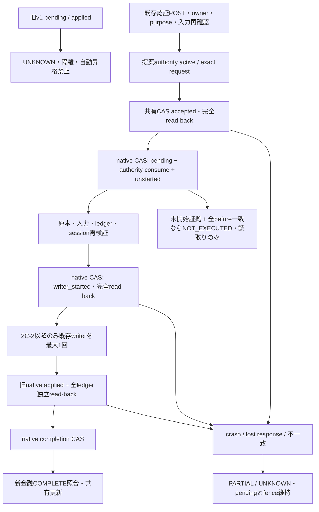

# Phase 5B-2B-2C-1：旧確認native契約の最小改修設計と合成PoC

対象は旧一般レシートと医療完全手入力。#137 head `4cb8e16f84386f5a9f464980cfb8d912b05bb967`
から独立分岐。mainのAGENTS.md、継続仕様全文（特に第10節）、#123～#137のhead/base/Draft/stateと
継承した実装を再確認した。確認1タブ・G103・H301・対応不明の旧医療p1を維持する。

到達点は**最小契約設計とwriterを一度も呼ばない合成PoC**。実金融authorityの発行、native schema改修、
旧writer接続、既存runner切替、本番運用の完成ではない。PoCのCOMPLETEは
`synthetic_only=True, real_native_complete=False, accounting_permission=False` を常に伴う。

## 1. 再調査した証拠と不足事項

| 必須事項 | 既存の再利用可能なコード／保存物 | 不足・最小追加仕様 |
|---|---|---|
| 本人・owner/session/purpose | `ExistingHostSessionGate.current/post`、`PurposeBoundary._post`、`VerifiedPost`、既存Google issuer/sub、browser ticket、Origin/CSRF、600秒TTL | 金融操作のserver側attestation digestとrequestへの永続binding。新ログイン不要 |
| 明示操作・入力 | `capture_inputs`、live UI、`ReceiptConfirmationPort._current/validate_draft`、一般record parsed/before、医療`_parsed` | 「その入力で記帳する」という認証済みPOSTの証明。Sheet編集、#131 acknowledgement、confirmation_hashだけでは不可 |
| 原本 | 旧source ID/hash/version、`verify_receipt_source`、#130 source observation、#133 TrustedOwnershipReader | Drive revision/numeric versionと独立native versionの対応。旧version文字列の代入で作らない |
| native request | `confirmation_operation_identity`、OperationRequestのUUID/fingerprint設計 | 旧金融operationと別のnative request UUID、全旧/修正入力fingerprint、同ID異内容拒否 |
| authority | protected old store・本人入力・既存実行境界、注入契約の`NativeInspection` | 旧経路にrevision/期限/消費を読むproviderは依然ない。#133定数revision=1／空request、FakeNativeは実発行物でない |
| native pending | `apply_confirmations`がwriter前にplan/hash、医療humanを保存 | request/authority/共有claimとのbinding、未開始・開始・完了の独立証跡 |
| CAS | `ConditionalRequests.replace`、`DriveRegistryIO.read_versioned/replace_versioned` | ReimportStoreをversioned IOへ依存性注入。read→無条件writeは廃止案。直列workflow lockをCASと見なさない |
| ledger | `_plan`の既存ID、append/update条件、duplicate、`_complete`の対象値照合 | 値とFORMULAの独立観測、全対象IDと全既存行、完全性、観測ETag/raw digest、before保存 |
| 開始／完了 | 旧pending/applied、#135/#136の通常取込用journal設計 | 旧確認専用のstart fence・native結果と正確read-back証明。#135 authorityへの流用なし |

現ツリーの`app`/`staging_shadow`に旧ReceiptConfirmation用のtrusted NativeInspection発行readerはない。
`NativeInspection`はdataclassの受渡し型で、それ自体がauthorityを発行・保存・認証するわけではない。
`ReimportStore`はv1 JSON保存、`DriveStateTransport.write`はDrive v3 updateの無条件write。
一方、同じDriveの既存`DriveRegistryIO`はv2 media PUTにstrong `If-Match`を付け、412、応答不明とも再PUTしない。
これは**コード上の再利用可能性**。今回実Driveのファイル・権限・ETag挙動へ接続して確認したものではない。

## 2. authorityの発行主体と消費契約（提案・実発行なし）

発行主体は既存本人確認hostのserver側native adapter。資格は既存Google検証済みowner/sessionと
browser ticket/Origin/CSRF/TTL、ACCOUNTING_POSTの明示操作、独立source観測と既存validator成功。
providerへ資格情報・生tokenを永続化せず、issuer/subからのactor IDとserver側attestation digest、
認証event/session参照digestを保存する。PoCはVerifiedPostに相当する**合成fixture**だけを使い、
署名発行・鍵作成・OAuth・HTTP入口を持たない。providerの実認証・実発行の検証は未実施。

最小の永続契約は次のとおり。

| 区分 | 必須フィールドと条件 |
|---|---|
| authority | issuer/provider version、actor/owner/purpose、認証済み明示操作digest、revision、issued_at/expires_at（既存600秒上限）、revoked、native request ID |
| request | canonical review ID/financial operation、native/shared request UUID、全request fingerprint、purpose/action、旧入力・確定入力・parsed/category snapshot。一般の明細identityと修正も含める |
| source | ID、bytes SHA-256、独立Drive revision/numeric version/native version、原本種別とpage/whole scope。既存scopeを仮Unitにしない |
| plan/before | 既存validator結果digest、順序付きplan、全対象table/ID/値/式、全既存行の値/式と完全性・strong観測tag/raw digest |
| native claim | authority revisionをconsumeしたrequest fingerprint、共有claim fingerprint/accepted event、全before、`unstarted(sequence=0)` |
| start | claim/request/plan/authorityへのbinding、単調sequence=1。既存native pending保存後、writer直前で条件付き保存し完全read-back |
| completion | native結果・保存済みpending/plan/request一致、start digest、独立全ledger read-backの値/式・観測tag/raw digest、既存行保持、source/input/revision一致 |

authorityはfresh waitingだけに発行可能とし、旧pending/appliedやG103/H301/旧p1へ発行しない。
未消費の間は入力・原本版・対象行・purpose/ownerの変更、logout/session失効、期限切れ、revision変更で無効。
共有claim取得後、native pendingと同じ条件付き更新でconsumeする。消費後に失敗してもunusedへ戻さない。
start直前に認証/session、authority、原本、入力、全ledger、共有claimを再検査する。
処理後のread-only照合では、当時の有効期間と消費/start証拠を検証する。期限切れを再実行許可へ変換しない。
現在のrevocation/source/input観測が不明・不一致ならUNKNOWN。再ログインだけで再所有させない。

## 3. 状態遷移と旧appliedの分離

順序は既存のvalidation → native pending保存 → 原本/live入力再検証 → writer → native appliedを保つ。
外側共有claimをpendingの前、startを最後の再検証後／writer直前に挿入する。native pendingとconsumeは
同じnative文書の1 CASにする。writer本体のappend/update/validator条件は変えない。
PoCではnative claim/start/completionの保存と独立観測だけをモデル化し、Wは存在しない。
full ledgerとcompletionの合成観測はテストfixtureから供給する。実pendingの更新／writer結果ではない。

新COMPLETEはshared claim、request/authority、start、native completion、現source/input/version、全ledgerと式、
全既存行、完全read-backが全て一致した場合だけ。旧`_complete`は必要条件の一部として再利用する。
旧appliedを根拠に新証跡を補完しない。#137の「writer前に止めてもfull観測でapplied」は13ケースを無変更で維持する。
NOT_EXECUTEDはnative CASに保存した未開始証拠と全before・観測世代一致が必要。ledger不在だけならUNKNOWN。
いずれの分類もretry/append/fence解放を許可しない。

## 4. ReimportStoreのstrong CAS案と同じbackend

productionのv1を今変更せず、提案v2は同じ既存private JSON fileのenvelopeとする。
`{schema: receipt-reimport-v2, revision, legacy: <v1 payload>, operations: <native evidence>}`。
旧confirmation itemの形はそのまま読み出し、証跡はoperation domainへ追加する。
**既存pendingのschema変更自体は避けられるが、native保存文書のversion付き拡張は必要**。
fieldをv1へ黙って追記して金融authorityに読み替えない。

PoC schemaは実名と分けた`synthetic-legacy-native-contract-v1`で、`legacy`の全値を変更せず保持する。
実v1 payloadは既存`validate_store`で検証。PoCはplain v1を自動wrapもsaveもしない。
既存`ConditionalRequests.replace`をそのまま継承し、変更するのはnative文書reader/schema validatorのみ。
新CASエンジン、DB、常駐サービス、Firestoreは不要。

CASは read(raw,strong tag) → native条件検査 → proposed revision+1 →
`replace_versioned(raw,tag,after)` → 完全文書read-back。
412を無条件writeへfallbackしない。応答喪失はwriterへ進めず、同requestのread-only照合だけ。
成功応答後でもread-backが不一致ならUNKNOWN。別requestのactive pending上書き／同原本再所有を拒否。
同じ保存先を共有する2/16個の独立adapterを競合させ、採用1件だけを検証する。

将来のtransportは既存`DriveRegistryIO`のversioned IOを既存ReimportStoreへ注入する。
設定はPDF registryのfile IDを流用せず、既存result file ID/folder/owner ACLへ固定する。
DriveStateTransport全体を改修すると他のproduction stateへ影響するため、その変更は不要。
もし当該ファイルのstrong precondition、ACL、media更新、サイズ/容量が実際には使えなければ切替停止。
同backend上の既存ファイルへのversioned IO適用を再設計し、別fileの作成が必要なら別承認を得る。
古い無条件writerが残る状態を「CAS化済み」と認定しない。

## 5. 合成PoCの範囲とテスト

実装は`staging_shadow/legacy_contract_poc.py`だけに隔離。実client constructorもwriter callableも持たない。
明示enabledとmemory-only IOが必要。authorityは`synthetic-contract-fixture-not-issued-authority`型のfixtureのみ。
`ReceiptConfirmationPort.validate_draft`、`apply_confirmations(dry_run=True)`、`_parsed/_plan`、
`confirmation_operation_identity`、read-only `_complete`、`PurposeBoundary._post`、
#133 TrustedOwnershipReader、同じConditionalRequestsを再利用する。

native journal／共有claim／ledgerは独立3保存先。全て前後二重readし、不一致ならUNKNOWN。
これは3保存先の同時snapshotや実DB transactionを証明しない。実backendの一貫性保証は残課題。
PoCのstartは証跡schemaの実験でありdispatchを意味しない。completionも明示的な合成証明で、実native結果ではない。

自動テストは一般・医療の正証拠、authority各項目欠損、認証/CSRF/session/purpose不一致、原本/入力/authority変更、
全行・数式・既存行の変更、不完全観測、旧pending/applied、部分入力医療、G103/H301/旧p1、
2/16-way、412、read-back不一致、claim/start/completion応答喪失、別request上書き拒否を検証する。
別processへ合成bytes/revisionを転送して再構築し、書込み0で分類一致を検証する。
これはOS電源断・実transport耐久性や永続disk復旧の試験ではない。
既存Drive IOの実メソッドをfake HTTPだけへ接続してIf-Match／412／503時のPUT最大1回も確認する。

## 6. 最小差分案と2C-2の実装範囲

今回変更するのはPoC 1、テスト1、設計1、専用CI1、既存CI分類テスト1の**5ファイル**。
`app`、旧native schema、既存runner/production workflow、認証baseline、既存writerは変更0。

2C-2は、承認された場合に**まず隔離合成で次のnative実装を行う**。本番切替は含めない。

| ファイル・関数（提案、未変更） | 必要な最小差分 |
|---|---|
| `app/receipt_reimport_production.py:ReimportStore.__init__/save` | v1 read-only／v2 envelope dispatch、既存validate_store再利用、versioned IO + ConditionalRequests.replace、native claimとpendingを同一CASにするsave条件、古いpendingは拒否 |
| 新`app/receipt_confirmation_contract.py` | existing host attestationを検証するissuer/reader、authority/request/claim/start/completion validator、ReceiptConfirmationのguarded subclass、全ledger read-back、旧appliedと金融結果の分離 |
| `app/receipt_confirmation_production.py:open_context/execute` | 将来切替時のみversioned IOと上記guarded service／mandatory gateを必須注入。裸のserviceへのfallback拒否。2C-2ではmemory compositionによる同等構築だけを先に検証 |
| `staging_shadow/native_accounting_sandbox.py:SINK_CALLERS/DENIED` | guarded subclassの既存writerへの明示delegate call siteを追加監査。検査を回避する動的getattr等は使わない |

上記は**native部分3ファイル＋既存合成mandatory gate監査1ファイル**の候補。
guarded subclassは既存`apply_confirmations`とwriterを継承し、writer直前overrideでstart保存後に既存本体へdelegateする。
`ReceiptConfirmation._write_accounting_plan`本体、旧validator、DriveStateTransportは改変しない案。
実際のnative claim順序と衝突するならそこで停止し、無断で並べ替えない。

ただしこの4ファイルで本番全入口が完成するわけではない。
共有金融CASの現在のwhole-source型`AccountingProbeRequest`はsynthetic_only専用であり、本番authorityに流用不可。
`OperationRequest`はUnit必須なので、whole sourceへ仮Unitを作って通してはいけない。
将来本番を対象にするなら、さらに`app/unified_receipt_write.py:parse_request`等に
正規whole-source request/ownership型を加える契約レビューが必要（native4候補に加えて計5ファイル以上）。
今回は#133の共有CASで合成契約を検証する範囲に留め、本番parserやproduction hostの金融POSTを追加しない。

既存runnerの迂回点は `receipt_confirmation_production.execute` の裸のReceiptConfirmation構築、
`apply_confirmations`のoptional request_gate、直接`_write_accounting_plan`、port.execute。
同時に走る通常取込/PDF全入口も同じownership fenceへ統一する必要がある。
既存host `unified_receipt_shadow`は金融transportを明示拒否し、#131もackだけなので、
そこから実authorityが自動的に発行される構成は現在存在しない。この接続も別工程でレビューする。

## 7. 互換性・段階切替・rollback・監査

1. v1はread-only readerで保持。旧pending/appliedはUNKNOWNとして一覧・保留し、自動昇格／解除／再dispatchしない。
   医療automatic intent、G103/H301/旧p1は解除対象にしない。
2. 切替前に全legacy実行を停止し、in-flight writerが0である証拠を取得する。
   workflow直列lockはdrain補助であってCASの代用ではない。裸の旧コード・cached writer・無条件transportが
   同じファイルへ書けるなら切替不可。全入口のmandatory gateと実行権限境界の検証が先。
3. 既存private保存先のACL/strong tag/raw SHAとv1全値、ledger値/式を監査・退避する。
   明示承認後、同じfileへIf-Match一回でv2 envelopeを導入し、全値read-back。新authorityは作らない。
   raw bytesの監査hashと退避原文はprivate保存し、Git/CI/AIへ出さない。JSON再encodeと原文bytes一致を混同しない。
4. 適格なfresh waitingだけを本人が原本・全入力を再確認し、新しい認証POSTからrequest/authorityを作る。
   過去のpending/appliedをコピーして証跡を補う処理は提供しない。
5. rollbackはv2対応read-onlyへ戻す。未消費grantを失効させ、既存claim/start/unknown/fenceは保持する。
   v1 backupをそのまま書き戻してlegacy writerを再開すると新claimを失うため禁止。
   read-only運用からの再開には全3保存先の監査と明示承認が必要。
6. 監査はnative/shared request、actor/owner/purpose、source独立版、before/plan/全ledger hash、
   consume/start/completion、ETag、各CAS結果を追跡する。ログへtoken/医療原文/個人データを出さない。

## 8. 判定と残る承認

追加の金融証跡とnative CASがあれば、既存writer/validatorを変えずに旧appliedと金融COMPLETEを分離する契約は設計できる。
新規DB・ログイン・CASエンジンは不要。**2C-2の隔離実装を計画できる**が、その実施は今回の承認ではない。
native文書v2とissuer/consume仕様の承認、legacy pendingとclaimを同一CASにするnative保存の実装、
guarded writer境界の安全レビューと全crash matrixが次の条件。
本番parser/認証金融POST/全runnerのmandatory gate、live source・ledger reader、実backend/IAM/鍵/監査/復旧、
iPhone実機、実データcanary、実authority更新、実記帳、Cloud、main統合は各別承認・未検証のまま。
G103/H301/旧p1解除、medical AI/OCR・自動authorityは提案しない。

専用Ubuntu CIで新PoC、#137停止13、#135/#136 writer/evidence、既存安全回帰とcompile/whitespaceを実行する。
確定件数・commit・runは新Draft本文と最終報告に記録する。成功は本番反映や旧writer接続完了を意味しない。
