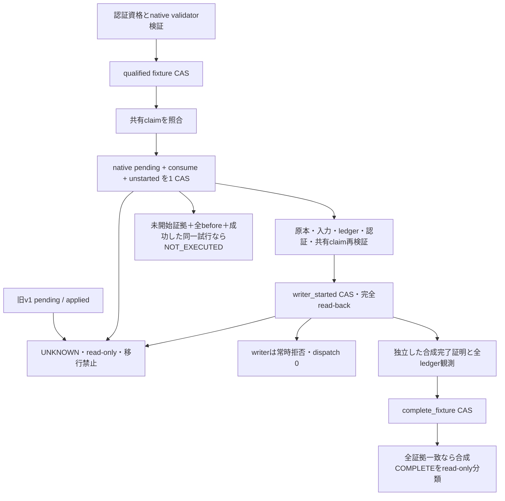

# Phase 5B-2B-2C-2：旧確認native v2の隔離実装

基点は#138 head `0689e279dee3dce8e862dda9d9c74e77e2ec067b`。mainのAGENTS.md・継続仕様全文、
#123～#138の説明・head/base/Draft/state、#137の停止13件と#138の設計・PoC108件を再確認した。
到達範囲は**一般／医療完全手入力のnative契約の隔離実装**。実writerも合成台帳writerも接続しない。
本番v1をCAS化済みと扱わない。確認1タブ、G103/H301、対応不明の旧医療p1は維持する。

## 変更範囲

| ファイル | 実装と不変条件 |
|---|---|
| `app/receipt_reimport_production.py` | `ReimportStore.isolated_v2`という明示factoryのみ追加。既定の`__init__/save`、v1無条件writeの動作は無変更 |
| 新`app/receipt_confirmation_contract.py` | strict v2/native request、既存CASによるstore、attestation検証、consume/pending、start/completion、read-only分類。writer callableを保持・実行しない |
| `staging_shadow/legacy_contract_poc.py` | 共通JSON／ledger／request基礎validatorを上記appへ移し再利用。旧PoCのschema・状態機械は維持し、108件を変更せず再実行 |
| `staging_shadow/native_accounting_sandbox.py` | 新factory／証跡変更メソッド／commitをprivate namespaceのDENIEDへ追加。writer call siteは増やさず既存AST censusを維持 |
| 新テスト／専用CI／CI分類テスト／本報告 | 隔離合成で検証。production workflowは無変更 |

`app/receipt_confirmation_production.py`、`DriveStateTransport`、ReceiptConfirmationとそのwriter本体、
ReceiptConfirmationPort、既存認証baseline/host、既定runner/constructor/production workflowは変更不要・変更0。
新しいfactoryを呼ぶproduction経路・環境変数・金融POSTは追加していない。

## v2 schemaとv1互換性

v2 rootは厳密に `{schema: 'receipt-reimport-v2', revision, legacy, operations}`。
`legacy`は既存`validate_store`で検証するv1 payload。全値・confirmation item構造を保持し、v2更新時に変更できない。
plain v1は隔離facadeでも既存validatorでreadできるが、金融操作・save・自動wrapは禁止。
本番データのmigrationや既存private fileへの書換えは行っていない。

operationは `{request, phase, qualification, claim, consume, pending, unstarted, start, completion}`。
未知key/schema、欠損、boolをrevision/sequenceに使う形式、不正UUID/hash/strong tag、非有限数、
request再利用・同原本多重operation、旧pending/applied、証跡の部分欠落・巻戻しを拒否する。
各記録のrequest/authority/plan/before/全ledger ID/入力/source bindingとdigestを照合する。

pendingは既存`apply_confirmations`のintentと同じitem形（status、plan、confirmation_hash、医療human）を
**新native operation領域**へ保存する。旧v1 itemのstatusを書き換えることではない。
consumeは同じCASにauthority revision、native request、fingerprint、pending digest、時刻を保存する。
pendingだけ／consumeだけの状態はschemaが拒否する。保存後に未使用へ戻す遷移やfence削除は提供しない。

## authorityと実行順序

資格の根拠は既存`PurposeBoundary._post`／`VerifiedPost`とowner、Google issuer、POST、CSRF、session、
600秒TTL、ACCOUNTING_POST、exact request/input binding。実hostの`ExistingHostSessionGate`は変更・接続しない。
`accept_fixture`はtrusted synthetic fixtureの資格を検証・保存するだけで、実authorityを発行しない。
providerは`isolated-receipt-native-v2-fixture`、authority自体も`synthetic-contract-fixture-not-issued-authority`を要求する。
Sheet入力、confirmation_hash、#131 acknowledgement、通常取込journal、単なるNativeInspectionを代用しない。

fresh waitingだけが対象。`ReceiptConfirmationPort.validate_draft`、実`_parsed/_plan`と
`apply_confirmations(dry_run=True, keys=[exact review])`を再利用する。dry-runがエラー状態を保存しようとしても、
read-only storeコピーで拒否し、旧v1を変更しない。医療は実手入力validatorのみで、自動origin・部分入力は拒否。
原本ID/hash、Drive revision/numeric versionとnative version、入力・カテゴリ・planはtrusted readerと前後一致させる。
新規rowの生成時刻だけは固定planの値を使い、既存行の時刻・値・式の変化は許容しない。

共有claimは同じConditionalRequestsと#133 ownershipのrelationで全原本／Unit・通常取込の競合を検査する。
native request、authority、shared request/fingerprint/accepted eventを固定する。
資格検証→pending保存→原本/live入力再検証という既存native順序を保持し、writerをその後へ接続したとは扱わない。

## strong CASとUNKNOWN

`IsolatedReimportStore`は既存ReimportStoreの明示隔離facadeで、CAS本体は
**変更していない`ConditionalRequests.replace`**に委譲する。新CAS engine・DB・サービスはない。
更新はstrong raw/tag読取り → expected revision/type検証 → native遷移・fingerprint検証 →
条件付きreplace → 全文書read-back → exact raw/revision/変更後strong tag再照合。
1回のCASで変更できるのは1 operation。legacy、過去request、consume/pending/start証跡は不変。

資格検証時のbefore観測tag/raw digestを保存し、consume/startでも一致を要求する。
CASの412、応答喪失、read-back不一致、tagが進まない応答は全てUNKNOWNとし、そのstore instanceの追加更新を禁止する。
UNKNOWNを記録するための追いwriteも行わない。無条件write・自動retryへfallbackしない。
成功した同一試行にだけ次の段階へ進むprocess-local ticketを渡し、再構築したinstanceは保存済みoperationを補完しない。

再構築後は、応答を受け取ったかという過去の通信結果を捏造せず、保存済み証拠だけをread-only照合する。
pending/startはUNKNOWN。完了証跡・全ledger・source/input/authorityが全て一致すれば合成COMPLETEを提示できるが、
それも再実行・pending解除・fence解放の許可ではない。
NOT_EXECUTEDには永続unstartedと完全なbefore（値・式・観測世代）に加え成功した同一試行を要求する。
ledger不在、qualifiedだけ、再構築したpending、開始証跡の応答不明からはNOT_EXECUTEDを推論しない。

既存`DriveRegistryIO.read_versioned/replace_versioned`そのものへ、資格情報なしのmemory HTTPを注入する結合試験も実施。
If-Match付きPUTと応答喪失後のPUT最大1回を検証する。実Drive/OAuth client、ACL・実ETagの接続試験ではない。
**既存productionのDriveStateTransport無条件write経路は残っており、本番CAS化済みではない。**

## 開始・完了とread-only分類

startにはpending/consume/claim digest、sequence=1、有効期限内の開始時刻を保存する。
保存・完全read-back前は次段階へ進まず、不明ならwriter未呼出しでもUNKNOWN。
`dispatch`は全状態で失敗する。実writer callable／合成writer DBへの参照・呼出しはない。

completionはprovider、request fingerprint、start/pending digest、全ledger値・式digest、観測token、時刻を検証する。
証明はtrusted fixtureから別入力として渡す。全行一致から自動生成した実native完了証明ではない。
native/shared/ledgerの独立3保存先とsource/入力/authorityを前後照合し、既存`_complete`もread-onlyで再利用する。
旧appliedや対象rowだけの一致、全行が見えてもstart/consume/completionが欠ける場合はCOMPLETEにしない。
値・式・既存行・ID・完全性・観測世代の変化はPARTIAL/UNKNOWN。どちらも追加append・再dispatch・解除なし。
全結果は`synthetic_only=True, real_native_complete=False, accounting_permission=False, writer_dispatches=0`。

## 検証と範囲

新nativeテストでは一般／医療について、authority欠損・失効・期限経過、actor/owner/purpose、source/input/version、
request reuse、旧v1 pending/applied、2/16個の独立store/controller競合、8 crash境界、4段階のCAS応答喪失／412／
read-back不一致／tag不変、開始証拠なしfull ledger、partial、G103/H301/旧p1、医療部分入力／自動拒否、
別process再構築、Drive IO fake HTTP、通常取込／PDF ownership競合を検証する。
競合は同じnative/shared backendを使用し、採用1・lost update 0。新native経路の実writer・append・自動再dispatch・
pending/fence解除は0。fixtureへ配置するledger観測行をwriter記帳と数えない。

#137停止13件と#138 PoC108件のテストファイルは無変更で維持する。
専用Ubuntu CIはこれら、新native、既存通常／買取証跡・writer、安全回帰、v1 store回帰を実行する。
既存回帰のfake/memory writer試験は従来の独立した検証であり、新v2をwriterへ接続した証拠に加算しない。
確定件数・commit・runは新Draft本文と最終報告へ記録する。CIはhead固定、contents:read、write flag false、
Secrets/Variables/environment/deployなし。既存production workflowは変更しない。

## 未解決事項と次段階

本段階の完成は**隔離native v2契約まで**。本番保存の耐久性/IAM/ACL/鍵/監査/復旧、実source/ledger reader、
実hostによる金融authority発行、Unit必須の本番request grammarとwhole-source型の接続、全旧runnerのmandatory gateは未検証。
3保存先の前後一致は同時transactionの証明ではなく、実backendの一貫性保証も残る。

次の旧writer合成接続には、別途承認のうえ、既存pendingをwriterへ渡すguarded projection/save adapter、
raw append/updateを限定したmemory DB、開始CAS後に一度だけ消費するdispatch lease、既存writer本体への明示delegate、
native結果保存と全会計read-backの結合、native完了後／共有更新前crashを含む全障害matrixが必要。
今回のblocked dispatchを外すだけでは接続完了にならない。既存writer/validator条件を緩和しない。
本番切替、実金融POST、実authority発行/消費、実記帳、原本移動、Cloud/deploy、main統合は別承認。
旧pendingの移行・解除、G103/H301/旧p1の推測mapping、医療AI/OCRの復活は行わない。

本番Spreadsheet・検証ブック・実Drive/Firestore/OAuth/医療情報へアクセスせず、新規Drive資源も作成していない。
既存PR #123～#138のhead/base/Draft/stateを維持する。新PRもDraftで保存し、mainへmergeしない。
