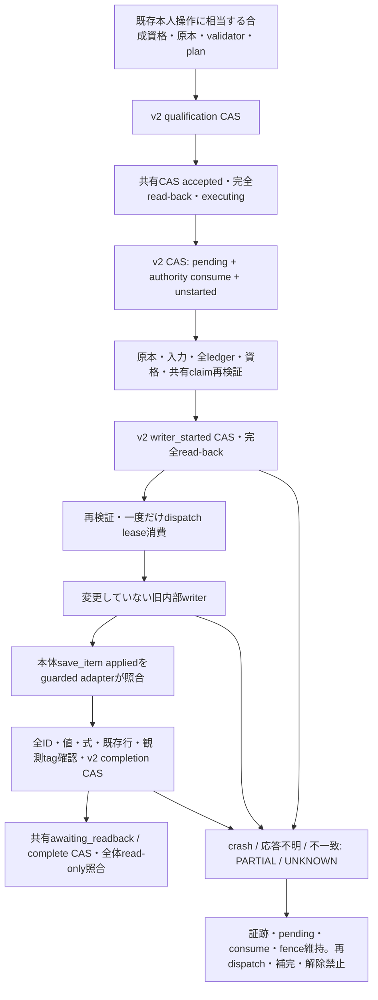

# Phase 5B-2B-2C-3：旧確認writerの隔離合成接続

#139 head `84befbf998ff832281e9bf9d3aab955ae8f00ada` から独立分岐。
mainのAGENTS.md・継続仕様全文（第10節を含む）、#123～#139のhead/base/Draft/state、
#137の停止13件、#138の設計・PoC108件、#139のv2・232件、#133～#136の共有ownershipとwriterを再調査した。
確認1タブのUI変更なし。G103/H301/対応不明の旧医療p1は保留維持。

## 範囲と実行の意味

一般と医療完全手入力だけを `SyntheticLegacyConfirmation` から、既存
`ReceiptConfirmation._write_accounting_plan` 本体へ明示的に委譲する。
一般は既存receiptのupdate＋2 expenseのappend＋importのappend、医療はreceipt/expense/importの3 append。
追加の一般fixtureでは既存expenseを同じIDのままupdateする。値・カテゴリ・修正内容は既存`_plan`の出力をそのまま使用する。
テストは実際の既存関数を呼び、その関数のDB呼出しでメモリ台帳が変わったことを照合する。
fixtureへの完成行代入・spy成功を今回のwriter成功には数えない。
対象actionは#139が許可した「候補明細で確定」「医療費を確定」「重複候補と別の支出として確定」。
既存支出への重複紐付けactionは#139の対象外のままで、新規接続しない。

本番入口、通常自動取込/買取の既存合成接続、PDF auto/manual/grouped、canary、明示Unit、
新1タブ金融入口は変更しない。PDF側は所有競合の拒否試験だけであり、writer接続の成功を意味しない。
通常自動取込・買取の#135/#136回帰227件を独立に維持する。

## 既存コードの再利用と境界

| 役割 | 再利用／隔離の方法 |
|---|---|
| 認証資格 | #139 `PurposeBoundary/VerifiedPost` のowner/session/CSRF/TTL/purpose/明示入力attestation。trusted synthetic fixtureのみ |
| 原本・入力 | #133 TrustedOwnershipReaderの独立原本版とsnapshot、既存 `ReceiptConfirmationPort.validate_draft`、`_parsed`、readonly dry-run、`_plan` |
| 共有CAS | 同じ `ConditionalRequests` のread/replace/transition、同じ `AccountingProbeRequest` と#133 `relation` fence。新CAS engine/保存先/authorityなし |
| native保存 | #139 `ReimportStore.isolated_v2`、`accept_fixture/consume/start/complete_fixture/inspect` を無変更で使用 |
| writer | `ReceiptConfirmation._write_accounting_plan(self,key,item)` の1か所だけ。writer/validator/plan/duplicateのproductionソース変更0 |
| DB | memory-only versioned IOに限定した`_MemoryLedger`。3表のreadと、そのplan順の単行raw append/updateのみ |
| native結果保存 | guarded `save_item` が本体の正確なapplied結果を検査し、v2 completionへ結合。旧storeのsaveは呼ばない |
| bypass監査 | 既存app全sink censusに加え、stagingの既存2 delegate＋今回1 delegateをAST censusで完全一致検査。#139 dispatch拒否と旧sandbox DENIEDは維持 |

**v2 schema・authorityは無変更**。`legacy`全値と旧itemは不変。
pendingは#139と同じoperation領域に置き、authority consumeと同じ1 CASで保存する。
writerへ渡すitemだけをpendingとしてprojectionし、最後のappliedをv1へ反映しない。
guarded writerの`apply_confirmations`と直接`_write_accounting_plan`は拒否する。
baseのunbound writerを直接呼んでもDBの実行context検査で停止する。
DB・結果保存も同じconsumed leaseの実行contextを要求し、外からappend/update/saveを呼べない。
既存本体のcode identityと単一実行frameも照合し、実行中callbackからの再入・DB直接write・applied捏造も拒否する。
既定production constructor/runner/workflow、v1無条件write経路は変更0であり、本番CAS化済みではない。

#139の共有native bindingはrequest全体fingerprintである。#133の旧inert
`SyntheticAccountingGate` が生成する `digest(asdict(NativePreflight))` とは異なる。
そのため旧gateを完了spyとして使わず、同じConditionalRequestsに既存request型を保存し、同じownership fenceを適用する。
新しい金融CASエンジンやnative authorityへ置換したものではない。
共有claimも完全なversioned read-backとstrong tag変更を確認してからconsumeへ進む。

## 順序と完了証拠

資格/claim/pending/startの成功応答が不明ならwriterは呼ばない。
開始証跡後は、書込み0件でもNOT_EXECUTEDへ戻さない。
writerの途中で各保存前に原本・入力・authority・共有claimを再検査する。
全行・全既存行の値/FORMULA projectionを別保存先から二重readし、保存順のprefixとstrong観測tagを比較する。
保存をACKしてもread-back/tagが一致しなければUNKNOWN。IO応答不明はstickyとし追加writeを拒否する。
既存writerが保存行のlost responseを値から認識できても、DBのUNKNOWNを解除して次行へは進めない。

完了certificateは#139の`complete_fixture`/providerをそのまま使う。
今回は任意のcertificateを受け取らず、実writerのapplied itemが保存済みpending＋status変更と完全一致し、
全予定DB呼出しが完了し、独立全ledgerと観測tagが一致した場合だけadapter内部で作る。
pendingのdigestはそのapplied結果の期待形にもbindingする。旧appliedやwriter戻り値だけでは保存しない。
native completion後・共有complete前の停止は、read-only新分類でUNKNOWN。共有状態を自動修復しない。

証明は引き続き**合成専用**：`synthetic_only=true / real_native_complete=false / accounting_permission=false`。
#139のfixture完了と実金融の発行物を区別する境界を解除しない。
writer dispatch数はそのprocess内の診断値であり、再構築後の0は過去のwriter未実行を意味しない。
過去PoCで供給したfull ledger/completionを今回の実writer成功へ加算しない。

## 障害・競合・復旧試験

一般・医療双方でqualification、shared claim、native consume、start前後、lease消費直後、
最初の会計行・複数明細prefix、全行後applied時、native完了前後、共有完了前後のcrashを試験する。
native4 CAS、共有4 CAS、ledger各保存のlost response/timeout・412・read-back不一致を注入する。
全行保存済みでもstart/consume/claim/completion欠落、既存行・数式・対象ID・観測世代の変更はCOMPLETEを拒否する。
同requestの再送はread-only、同ID異内容・別requestで同原本の再所有は拒否する。

2/16個の独立adapter/store facadeが同じbackendを共有し、native qualification CASを同時競合させる。
直列lockは使用せず、採用した1試行だけが共有claim/native consume/start/writerへ進む。
保存先transport内部のlockはメモリIOのIf-Match原子操作のモデルであり、adapterの分散lockの代用ではない。
全対象IDの重複がないこととdispatch総数1を照合する。
通常/買取のwhole-source、grouped Unit、PDF auto/manualの異なるsource-kind/partition観測との競合も停止する。
画像にPDF用identityを推測付与して接続しない。異なるkind/partitionはUNKNOWNのまま。

保存済み3文書のbytesとrevisionを別Python processへ渡し、writerを呼ばず分類を再構築する。
これはsynthetic memory状態転送の試験であり、実Drive/Sheetsのdurabilityや電源断を実証しない。
再構築は`fresh_attempt=false`が既定。初回CAS前の412など証拠が残らなかった場合も、
再構築readerからsubmitして新たな試行を自動開始しない。
新しいfresh compositionを作ることは、UNKNOWN operationのretry/復旧許可を意味しない。
今回、そのような自動復旧入口は作らない。

専用Ubuntu CIは新writer試験、#139の232、#138の108、#137の13、通常/買取227、既存全安全selectorとv1 storeを実行。
collect node IDと個別PASSEDを照合する。確定件数・head commit・run結果は新Draft PR本文に記録する。
Windowsで固定bundle hashが一致しない既存回帰は条件を緩めずUbuntuで検証する。

## 本番への影響と残工程

変更範囲は合成adapter・sink監査、テスト2ファイル、報告書、新規専用Ubuntu CIの6ファイル。
`app`変更0、既存production workflow変更0、既存native schema/authority変更0。
実Google/OAuth/Drive/Firestore/医療、既存Spreadsheet/検証ブック、新Drive資源、原本移動、AI送信、
実authority発行/消費、実会計write、Cloud/deploy、main統合は0。

PARTIAL/UNKNOWNには追加append・不足行補完・自動再dispatch・pending解除・fence解除・旧applied補完を提供しない。
別保存先を同時transactionにしたわけではなく、途中停止の全行一致は完了不足として保留する。
手動監査・read-only照合と明示的な復旧設計が残る。

PDF入口へ進むには、実際のPDF/Unit purpose・source/page/Unit/partition/authority・native requestと
既存claim順序を別途調査し、各native pending/start/completion、guarded writer、全ledgerの独立観測を結合する必要がある。
whole-source確認のauthorityや今回のadapterをPDFへ使い回さない。競合/partial/16-way試験と別承認が必要。

本番はさらにwhole-source financial request/金融POST、既存hostの実attestation/issuer、実ACL/ETag/ledger reader、
全旧runnerのmandatory gateと無条件v1 writerのdrain、本番CAS切替・migration/rollback・監査・復旧、
iPhone本人確認操作の実機受入、限定canaryが未実装/未検証。
実金融authority、production runner切替、金融POST、実データ/記帳、Cloud、main統合はそれぞれ別承認。
今回の合成writer接続を本番運用開始の根拠にしない。
