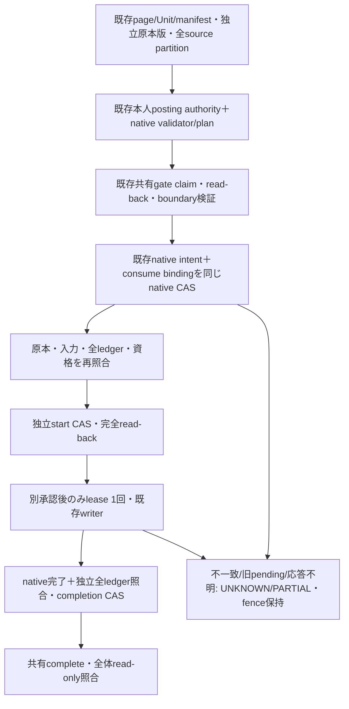

# Phase 5B-2B-2D-1：PDF native契約調査と最小接続案

調査基点：#140 `40d824c7bf1b2b8b28df598d67fe30700f32281d`。main `d62e1e254692e676f4e4a72dc593524a80fbea08`。
mainのAGENTS・継続仕様全文（第10節含む）、#123～#140のmetadataと継承コードを確認。
今回は設計と読取り専用合成対照だけ。新writer接続・authority発行/consume・金融claim・本番アクセスは行わない。
P201/P202の既存構造状態を読み替えず、G103/H301/対応不明の旧医療p1を保留する。

**結論：最初のPDF接続候補は「登録済み一般PDFのmanual posting」**。
既存の本人記帳許可と入力確認を利用でき、iPhoneで原本を確認して確定する流れに近い。
ただし現契約のまま安全接続済みとは判定しない。共有claim・独立原本版・source全体partition・開始/完了証跡の小規模拡張が必要（分類C）。
PDF writerをMVP運用開始の必須依存にせず、[全体ロードマップ](iphone-practical-mvp-roadmap.md)の認証・一般/医療・mandatory gateを優先する。

## 1. 実コードの入口比較

ここで「manual」は**一般PDFの既存候補を本人が修正・確定する経路**。医療完全手入力ではない。
全てコード上の存在・制約であり、現在の本番設定/有効化/保存物の存在は未調査・未確認。

| 入口 | 実際の呼出し・writer境界 | source/page/Unit/partition identity | authority（発行・検証・消費） |
|---|---|---|---|
| PDF auto | `pdf_intake_production.process` → `PageIntake.post_normal` → `_post` → `ScopedWriter` → `ReceiptPipeline._materialize_result` | PageUnit source ID/hash/count、stable page、既存 `page-receipt-v1:*`、receipt_index/bbox/segmentation manifest。全source partitionのdurable readerは未接続 | `AuthorityAdapter.authorize(single_page_ai)`の`automatic_normal`、未UI投影・未修正・既存evaluate成功。本人の金融grantを持つとは扱わない。単回性はintentで制限。独立consumeなし |
| PDF manual | `process`のUI投影済みUnit → `post_manual` → `_post`。`PDFManualUnitPort.inspect/execute/readback`が別の統合境界 | 上記＋確定snapshot/item identities/segmentation。portはcase Unit/index/pageを照合 | `DecisionSealer.seal`は既存hostのverified actor専用。`receipt_posting`は送信許可と別MAC binding。`AuthorityAdapter`で検証、`ConfirmedItems`とactor/snapshot/parsed/planを照合。intent作成と明示consumeの結合は未実装 |
| Grouped Unit | `GroupedUnitPort` → trusted `GroupedPlan` reader → pinned `DriveUnitProcessingStore.reserve/verify_pending` → `ScopedWriter`＋既存materializer → `complete` | `pdf-confirmed-unit-v2:*`、全member page identities、page_numbers、grouping_revision/proposal/confirmation digest。ページ内bbox Unitとは別型 | grouping confirmationは構造専用。金融`NativeInspection`と既存plan/current verifierを別途注入する契約。実発行readerはこのtreeで見つからず、testsのFakeNativeを発行物にできない |
| 固定canary | `receipt_plan.posting_live.main` → `posting.execute` → `ScopedMaterializerDB`＋既存materializer | 固定14ページ原本のp14、固定context/identity、10明細/3801円/-13円の専用budget | operator-only `posting.approval`＋既存OIDC確認snapshot。grantはdigestであり、新しい本人認証ではない。private保存ACLがtrust境界。unused→claimedが実行権の消費。最大24時間、有効期限/owner/plan/before一致 |
| 固定canaryの歴史的PDF Unit variant | `pdf-unit-write-canary.yml` → 歴史的 `pdf_unit_write_canary.execute` → `pdf_receipt_write_canary.run_canary` → `AppendOnlyDB` → 既存pipeline `_process_image_bytes` | 固定normalページの既存unit_ids/page_identities、grouping revision/confirmation、operator manifest。別branch/指定SHAを検査して実行する専用workflow | operator指示・先行read-only run/署名済みproof・fresh privacy/source。p11等の専用stage。汎用PDF本人金融authorityではない |
| 明示Unit | `unit_posting_live.main` → `unit_posting.execute` → 同既存writer。`ExplicitUnitPostingPort`もこれへ委譲 | **同じ固定原本のp4/p10だけ**。context/rid/Unit/index、plan-only受付との一致 | operator-only `unit_posting.approval`、fresh OIDC/HGA/input確認、個別budget/TTL/owner/context。unused→claimed。p14許可の流用不可 |
| ページ構造・種類・privacy | `ExistingReviewPort`/`PurposeBoundary` → pinned `DurablePdfGrouping.review`、page-kind、HumanGeneralConfirmation。groupingの読取りは`confirmed_units` | 原本ID/hash/version、全stable pages、proposal digest/revision/partition。構造操作に仮Unitは不要 | STRUCTURE/METADATAのみ。既存認証POST/owner/CSRF/TTL。grouping flagsは`accounting_allowed=False`。種類・送信許可も記帳許可ではない |
| 医療を含むPDF | 全page privacy観測 → `PageIntake.analyze`は`medical_manual_pending/privacy_held`。`Projection.pending`は保留表示。pinned processingの`medical_manual`は**既存手入力backendの完了参照のみ** | medical page-kind specと既存manual reviewの独立した対応証明が必要。grouping Unitを医療許可へ使わない | PageIntakeの一般 `AuthorityAdapter`はmedical/payrollを拒否。医療用financial provider/一意mappingは今回確認できない。#140 whole-source医療authorityをPDFへ移植しない。旧p1は未対応のまま |

| 入口 | native request / pending / CAS | ledger / 対象ID | 開始・完了・読戻し | 共有CASとの競合／不足・最小改修 | 実用性 |
|---|---|---|---|---|---|
| auto | `_post`がfresh UUIDを生成。`intent={request_id,plan,candidate_digest,source_hash,status,claimed_at,posting_binding,before_ledger_digest}`。RegistryStore strong If-Match＋全文書read-back | receipt/expense/import。`sid=pdf-receipt-<既存Unitのsuffix>`、`R-sid`、`R-sid-NN`、`receipt:sid` | claimed→complete/imported、plan digest/readback IDs。**writer_startedなし**。recoverは全行一致からnative完了を保存できる | whole/同Unit/overlap/版不明と競合。新共有claim binding・source版・partition・開始/完了/全before証跡。自動処理の資格を本人金融grantと偽らない | 後回し可。manual接続後、同じnative契約を自動条件に接続 |
| manual | authority側の既存request UUIDとconfirmation_journalを照合。`_post`生成のintent UUIDとは別。現intentは双方と共有claimを完全にはbindingしない。同registry CAS | autoと同じID体系。既存明細/カテゴリ/修正値はevaluate/planが決定 | exact_readbackは値/FORMULA/全旧行digest。完了statusだけでは共有金融COMPLETE不足 | 既存sealed authorityをそのまま検証し、native/authority/sharedの3 requestを固定。consume＋pending同CAS、独立start、guarded lease、完了readback。**第一候補** | 一般PDFを本人確定できるためPDF内では高い |
| grouped | native reserveはUnit/route/input_digest/planned_rows/writer_referenceをintent_digestへ固定。UUID request/金融consume/startはない。ConditionalDriveStateTransportV2＋strict processing schema | 通常routeは `R-<pdf-confirmed-unit-v2:...>`、同expense suffix、`receipt:<Unit>`。他routeへ転用不可 | pending→applied、reserve/complete audit。completeはtrusted callbacksのcurrent/readbackに依存。開始なし | native storeは**ページ重複を拒否**しbbox別Unitへ拡張不可。金融issuer/host compositionと開始証跡不足。native strict schema改修を別設計 | 複数ページ1領収書には必要だが低頻度なら保留可能 |
| 固定canary | grant request＋attempt UUID。PostingStoreのunused/claimed/unknown/completeとgeneration、If-Match | `R-<既存receipt_unit_id>`、expense suffix、`receipt:<Unit>`。固定budget | complete result/永続current/year history、outcomeは全値/式/旧行検査。claimedはwriter開始ではない。replayはread-backだけでもfinish可能 | shared claim、source/partition、独立start不足。専用grant/scopeを拡張して一般化しない | MVP機能ではない。運用者用の限定試験 |
| 歴史的PDF Unit canary | CanaryStoreは既存v2 conditional transportでpending→applied、plan/proof/input/PNG digest。汎用native UUID/共有claimなし | Unit IDをsourceとして3表へ。通常materializerのIDを維持 | verify_planは対象row値/存在を確認。独立FORMULA/全旧行/start/新COMPLETE証明は不足 | 現mainのappにはこのmoduleが無い。指定歴史的SHAのwriter実行は現在のapp gateだけでは遮断できない。workflow権限/drainも対象 | 当面E。一般化しない |
| 明示Unit | 既存rid/context/attempt、専用PostingStore CAS。plan-only受付は権限ではない | Unit由来3表ID、本人確認から実budget算出 | 上記＋厳密なUnit/history binding。開始証跡は別途必要 | adapterだけで一般PDF化不可。p4/p10境界は不変。証跡拡張が必要なら別承認 | 歴史的対象のため当面保留 |
| 構造等 | request UUID/intent digest、DriveGroupingStore versioned IO・audit。構造revision。`display`はsync/saveし得るため純粋GETでは呼ばない | 会計ledgerなし。confirmation/Unit定義のみ | grouping_confirmed/confirmed_unitsは金融完了ではない | 同じConditionalRequestsをpurpose別に共有できるが、financial scope/authorityを付けない。一覧GETは保存済みprojectionのみ | PDF保留理由・構造下書きはMVP必須。構造POST完成は後追加も可 |
| 医療PDF | 保留のnative stateと既存manual backend。processingはreference-only/empty plan。金融request・mappingの証拠不足はUNKNOWN | 新しい医療会計IDを推測しない。既存手入力backendのIDを保存前後で照合する必要 | 既存manual完了参照だけでsource PDF完了を推測しない。全page/Unit terminalが必要 | 一意mapping・手入力validator・本人authority・shared/native証跡が必要。自動medical routeは作らない | 完全手入力の安全性は必須。PDFへの自動連結は後回し可 |

コード参照：`app/pdf_intake_runner.py`（`plan/_post/post_manual/recover/exact_readback`）、
`app/pdf_intake_registry.py`（`validate/RegistryStore/DriveRegistryIO`）、`app/pdf_intake_authority.py`（`binding/DecisionSealer/AuthorityAdapter`）、
`app/unified_receipt_native.py`（PDFManualUnitPort/GroupedUnitPort/ExplicitUnitPostingPort）、
`app/receipt_plan/{posting,posting_live,unit_posting,unit_posting_live,unit_runner,drive}.py`。
Groupの原実装は現appではなく、`auth-session/baseline.json`がpinする
[`c29ecc44:pdf_unit_processing`](https://github.com/tmoriuchi1401-source/kakeibo-ai/blob/c29ecc44e1fb9fcc854cde1da5cce940e633e8fa/app/pdf_unit_processing.py)
と[`pdf_grouping_authority`](https://github.com/tmoriuchi1401-source/kakeibo-ai/blob/c29ecc44e1fb9fcc854cde1da5cce940e633e8fa/app/pdf_grouping_authority.py)。
両fileは最小hostのbaseline whitelistに含まれず、testsは`compose(test_tree=True)`の歴史的treeからloadする。
このテスト用存在を現在の本番hostへの搭載・有効化証明にはしない。
PDF manualの既存発行側は `auth-session/generic_review.py:RegisteredJournal.replace`。
verified actor/ConfirmedItems/evaluate/plan bindingを再検査し、posting sealと確認journalを**同registry CAS**で保存する。
`auth-session/generic_intake.py:verify_registered_proof`はmachine identityで既存proofをread-only検証する（本人sessionの代用ではない）。
両方はhash固定bundleのadded_filesで、実環境の設定・稼働・実発行物の存在は今回確認していない。

## 2. Unit ownershipの具体的な境界

1. **原本全体とUnit**：#133 `relation`は同sourceのwhole対unitを常にconflict。通常取込/買取/旧確認からのwhole処理と同じbackendで排他する。
2. **同pageの複数領収書**：page-receipt manifestの既存index/UID/bboxを使用。全体で同じ確定partition、異なるUID、非重複bbox、ledger ID非重複の場合だけ独立。別request UUIDでは所有権を作り直せない。
3. **別page/複数page Unit**：同じ原本版・確定partitionが前提。groupedのpage-level reservationをpage内bbox reservationへ読み替えない。既存processing storeはpage重複を拒否するため、共有CASがindependentでもnativeが拒否する組合せは停止。
4. **grouping変更後**：proposal/revision/member変更は古いpending/ledger/fenceを解放しない。old UIDを新UIDへ対応付けずUNKNOWN。新partitionへ自動再所有しない。
5. **既存ledger**：全対象IDとsource/Unitのtrusted mapping、旧行値/式/完全範囲を独立検査。不明行を金額/日付からUnitへ推測しない。
6. **duplicate/replay**：native duplicate（ID存在・近傍同額等）、共有request reuse/fingerprint、Unit ownership、native intent/claimを全て維持。metadata/reconciliationの成功から金融許可を生成しない。

### 今回確認した重要な不足

- `verify_registered_pdf_partition`は**選択pageのmanifestだけ**からunitsを作り、source partition全体と完全一致比較する。
  他pageにUnitがあるPDFではaggregate partitionと一致しない。選択pageだけを全sourceの確定partitionと偽って通さない。
- RegistryのPageUnit sourceはID/hash/countであり、`Context.source`はmetadata versionを読取前後に確認するが**bytesだけを返す**。
  Drive revision/numeric version/native versionを金融operationへ永続bindingするreaderは別途必要。
- per-page manifestはあるが、全sourceについて独立した確定partition revisionを読み出すproduction providerは見つからない。
  generic registry generationはintent/完了でも進むため、その都度partition revisionとして代入すると自身のclaimでstaleになる。
  fixtureのrevision=1を本番のnative証拠へ代用しない。
  今回のrigは3-page sourceのうち1-pageだけを登録しても旧helperが通る対照を確認した。これを全source partitionの成立証明にはしない。
- groupedの金融`GroupedPlan`/NativeInspection providerはappにfactoryがない。構造confirmationとFakeNativeを代用不可。
- `post_normal(apply=False)`やGroupedUnitPortのplan再生成も**既存materializerをPlanningDB上で呼ぶ**。
  「dry-runならwriter関数を一切呼ばない」は誤り。今回その呼出しはfail spyでbody実行前に停止した。
- native full ledger一致だけでrecover/finishできる旧経路は、新COMPLETEの独立writer開始証拠にならない。

## 3. 最小方式の比較と順位

A=現native契約をそのまま使用、B=adapter追加のみ、C=小規模native保存/証跡/CAS契約追加、D=発行主体/広いschema/host見直し、E=保留可能。
安全接続は共有claim＋native consume/start/completeが揃う基準で比較し、spy到達可能という理由でA/Bとしない。

| 順位 | 入口 | 判定 | 工量/実用性/保守性 |
|---|---|---|---|
| PDF 1 | 登録済み一般manual | **C**（現状A/B不可） | M。既存MAC・確認journal・registry CAS・writer/読戻しを利用。独立金融権限がある。native v2証跡/partition readerの承認が条件 |
| PDF 2 | auto | **C**、MVPではE可 | manualと共通の保存/開始/読戻しを再利用。ただしautomatic資格は別。新AI送信接続や本人grantの自動発行は含めない |
| 非金融・並行 | 構造/種類/保留 | **B（既存purpose adapter）**。本番のsource/host配備は別課題 | 下書き/読取り/保留は既存1タブを維持。構造POSTだけなら金融writer拡張不要。金融A/Bには分類しない |
| PDF 3 | grouped | **C＋金融issuer未解決ならD** | L。既存reserve/CASは使えるが金融provider、host packaging、source partition、strict processing evidenceが不足。低頻度ならE |
| PDF 4 | 医療PDFの自動連結 | **D/未対応、E** | L。一意manual-backend bindingが先。手入力は既存backendで維持し、未対応PDFは明確に保留。医療自動記帳/AIは対象外 |
| PDF 5/6 | 固定canary / 明示Unit | **証跡はC、一般化はD、MVPではE** | 専用原本/p14/p4/p10の運用者機能。接続の容易さを理由に最初の一般PDF入口にしない |

S/M/Lの作業規模と全体の開発順序はロードマップを参照。利用頻度の実測は今回していない。
選定は仕様の「本人がiPhoneで原本・入力を確認して確定」を優先した技術判断であり、実ユーザーのPDF頻度の断定ではない。

## 4. 第一候補の具体的な最小差分案（未実装・要承認）

**現writer、validator、authorityのMAC schema、既存UID/index/native UUIDは変えない**。
次のnative保存envelope拡張は必要だが、まずmemory-onlyに隔離する。実file migration/authority発行は含めない。

| 予定file | 差分と再利用 |
|---|---|
| 新 `staging_shadow/pdf_manual_contract.py` | 既存RegistryStoreのnative load/save view＋既存ConditionalRequests CASを使う隔離v2 facade/contract。source全体partition・3 request binding・consume/start/completionのstrict validation。既存schema/既存PageIntake既定constructorは変更しない |
| `staging_shadow/accounting_native_preflight.py` | v2専用のsource全page catalog照合を追加。全manifest/held page/版/既存UIDを集約し、保存済みpartitionと一致する時だけread-only preflight。現在のpage-local helperを無断で緩和しない |
| `staging_shadow/native_accounting_sandbox.py` | 新native証跡操作と将来delegateのdeny/census。旧writer拒否は一般開放しない |
| 後続writer接続時のみ、新隔離composition（上記module内または同等1file） | #133 SyntheticAccountingGateの既存probe callback内でだけnativeを実行。save viewがnative intent＋consumeを同じCASにし、start保存/読戻し後だけ一度限りleaseを作る。ScopedWriter/materializerと限定memory DB。archive/AI/projection writeを注入しない |

契約段階はruntime **3 file候補**＋tests/fixture/文書/専用CI。writer接続で必要なら隔離composition 1fileを追加。
app/production runner/認証/既存writerを最初から一般化する案は採らない。
save facadeによる正確な元native順序の保持が証明できなければ、**runnerに必要な最小hookの差分を提示して停止**し、別承認を受ける。
mutable dictのalias書換え、旧apply/recoverの迂回、validator複製で通さない。

### 提案v2保存契約

既存private registryと**同じversioned IO/backend**を使う。新DB/独立CAS/serviceを作らない。
memory fixtureの例：`{schema: synthetic-pdf-execution-v2, revision, legacy: <既存registry>, source_partitions, operations}`。
root revisionに既存ConditionalRequests.replaceの+1/If-Match/全文read-backを使用する。
`legacy`はPDFの既存native intent/status/readbackを更新するため、#139のimmutable legacyとは異なる。
変更は選択Unitのnative遷移だけに限定し、全他page/Unit/authority/入力を不変とする。既存v1 validatorへ投影して確認する。

- `source_partitions[source_id]`：独立原本版、全page観測と固定manifest、既存UID/index/bbox/member、privacy/holdの観測digest。
  source全体の一度保存したpartition revisionとdigestを保持。自身のintent更新でrevisionを作り直さない。
  全sourceの確定を証明できなければ作らず停止。grouping_requiredや未観測pageを推測で埋めない。
- `operations[既存pdf_operation_identity]`：既存authority request UUID＋確認journal fingerprint、**元nativeが一度だけ作るintent UUID**、共有request UUID/claim fingerprint/preflight digest、owner/purpose、原本独立版、入力/plan/全before値/式/観測tag。
- `consume`：元のsealed authority digest/actor/rid/revisionとnative intent、共有claimを同じnative CASでbinding。seal内容を再発行・書換えない。失敗後unusedへ戻さない。
- `start`：上記bindingと単調sequence=1。native intent保存後に原本/入力/ledger/認証/authorityを再検査し、CAS保存・完全read-backしてから実行leaseを消費。
- `completion`：元nativeの正確なintent/status/readback結果＋独立全ledger/式/全旧行/観測version/tag。共有complete前停止はUNKNOWN。native importedだけで新COMPLETEにしない。

v1 pending/appliedや既存完了行をv2へ自動昇格しない。v2があっても履歴/版/partition対応不明はUNKNOWN。
共有CASのpreflight digestは#133の実際のNativePreflight digestにbindingし、#139旧確認用fingerprintを流用しない。
source partition qualificationはgateより前、native pending/consumeは**gateのboundary検証後**に行う。
NativeReadAdapterが検証中に自身のnative更新をstaleと判定する順序へしない。

## 5. 今回のread-only検証と限界

新testsは`test_pdf_native_readonly_inventory.py`。
既存`test_pdf_intake_runner.rig`をそのまま用いて得る合成candidate/manifestを凍結し、既存UID/indexを再割当てしない。
fixture準備のmemory registry 2更新は既存rigの初期化のみ。その後のsave/replace/appendはfail spy。
authority seal/approval、materializer body、Google clients、socket接続は初期化時から拒否する。
金融authorityや金融requestを作って成功fixtureへ昇格する検証はしない。

対照：authority/native intentの不在、元source/Unit binding、whole/同Unit conflict、Drive/native版・partition変更、
旧pending/unmapped ledger拒否、strong tag必須、source bytes/authority revision不一致、medical privacy/自動処理拒否、
writer計画境界での安全停止、legacy full/partial/formula read-back、P201/P202のSTRUCTURE専用投影。
歴史的nativeはpin SHAからgit showでASTを読むだけで、compose/authority操作を実行しない。
既存Unit間独立/16-way/異常終了の#133/#134成功は過去CIの証拠として再利用し、今回新しいPDF接続成功とは数えない。

専用Ubuntu CIはこの新規読取り検証、既存の純粋1タブ下書き対照（金融副作用なし）、workflow境界、compile/whitespaceのみ。
writer/authorityを実行する#140までの全安全suiteは今回は再実行しない（直前#140の2701成功を履歴として参照）。
今回の実測件数/commit/runは新Draft本文へ記録する。実原本・本番保存物・実OAuth・iPhone実機は未確認。

## 6. 承認と次工程への判定

**調査・設計は完了可能。writer接続可能の実証ではない。** A/Bで接続可能なPDF金融入口は確認できなかった。
manualの小規模native v2と全source partition readerを最初に検証する案へ進める。
正しいpartition/本人authority/source独立版のreaderが構成できなければ、その案件は未接続のまま停止する。
v2保存契約・隔離実装の範囲は次のユーザー承認が必要。実writer接続、本番schema migration/authority/financial POST、
本番constructor/全runner gate/live Google、Cloud、main統合、canaryは別承認。
次の具体的なCodex指示案はロードマップ末尾に示す。
