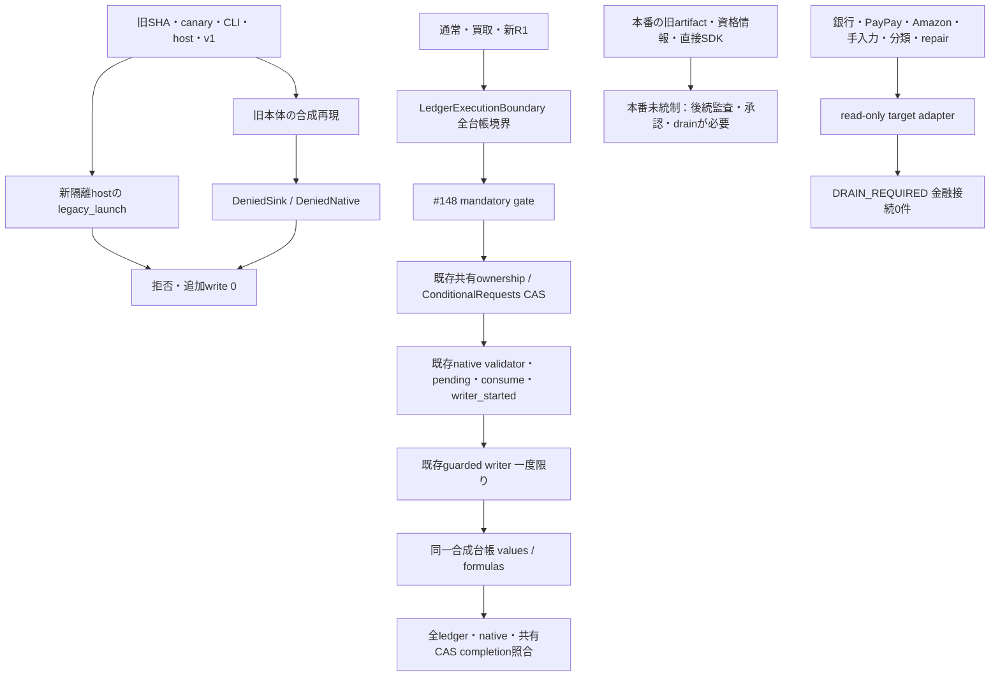

# R2-2 M5・M6：隔離実行境界と共有台帳更新の保留

基点は PR #148 の `540427f865c47066a7d8b3e3a0e0c7ae714fd7c8`。main AGENTS.md、継続仕様全文（iPhone確定UIを含む）、#133〜#148の依存関係・実装、#147の39入口・静的censusを参照した。独立Draft PRのみへ保存する。旧39件のA〜E判定は変更しない。

今回の結果は **新しいmemory composition内の遮断・競合検出**。本番の全入口閉鎖ではない。A01〜A13はtarget観測とdrain-required判定までで、**M6個別writerの金融接続は0件**。通常・買取・新R1だけが#148の既存writerで合成台帳へdispatchできる。個別の銀行・カード等の金融接続と本番権限境界は残件であり、本番有効化可能とは判定しない。

実行したCIのURL・commit・JUnit実測件数はこのDraft PR本文へ記録する。collect-only件数や以前のCIを今回の実行件数へ加算しない。

## 実装と責務

`staging_shadow/ledger_execution_boundary.py` に追加した `LedgerExecutionBoundary` は、新DBやCAS engineを作らず、既存の `ConditionalRequests` が使うversioned IOを外側で限定する。

|境界|処理と保証範囲|
|---|---|
|`compose_receipts` / `ReceiptRuntime`|#148 `MandatoryReceiptComposition`をそのまま構成。同一共有storeと同一全台帳storeを必須化。別storeへの差替えを拒否|
|`_run` / `_fresh`|全台帳values・formulas・opaque versionと旧更新nativeの独立観測。各共有CAS／台帳CAS直前に再確認。原本・native・writer_started照合は#148を再利用|
|`_BoundaryPort.replace_versioned`|#148の限定portから、正しいreceipt実行context内だけCAS可能。直接writer・port・SDKは金融capabilityを持たない。CAS失敗・timeout・応答喪失は同じcontextを不確定化し、cleanup writeしない|
|共有CASでの新operation追加|全台帳snapshotを共有するため、別sourceでも旧accepted/executing/UNKNOWN等が1件あれば拒否。完了済みでも共有completeラベルだけでは許可せず、既存native証明と現在の全対象行values/formulasを照合|
|`inspect_update`|A01〜A13のnative/source namespaceとledger/table/固定ID/観測row/column・values/formulasをread-onlyで返す。rowをdurable identityとして使わない|
|`inspect_daily_correction`|代表実装。既存`DailyCorrections._requests/_read_target`とbefore fingerprintを再利用。prepare/apply/saveを呼ばない。queuedでもDRAIN_REQUIRED。pending/applied/UNKNOWNは保留|
|`execute_update`|常に金融拒否。`drained=True`や`approved=True`等の自己申告でも開かない。将来、既存native authority固有のadapterを別途実装・審査する必要がある|
|`legacy_launch` / `DeniedSink`|旧入口のlaunch要求、DB append/update/native save/解除/初期化、SDK append/update/batchUpdate/clearを隔離hostで拒否。資格情報・callback・任意コードを渡す口は作らない|

memory backendは実際に排他的CASを行うfixtureを使い、`supports_strong_cas`を明示要求する。これは実Sheetsの強いCASの証拠ではない。read-backが一致しただけの弱いbackendは拒否。原本・native・共有store・台帳は別保存先であり、単一transactionではない。部分成功とUNKNOWNは保持する。

DailyCorrectionsのread-only adapterもstore/DB/native IOすべてにmemory専用条件を要求し、nativeが固定IDで読んだ行と共有台帳の同じ行が完全一致しない場合は拒否する。実Google transportを読取り用途で注入する口も作らない。

Python内部objectや生backendを所有する任意コードに対するsandboxではない。旧hostへ生SDK権限を残したまま、このwrapperだけで本番の迂回不能性は保証できない。

## 接続図

## M5の入口別結果

詳細な起動元・chain・sink・固定ref/ファイル/関数/行番号・根拠文字列は [機械可読一覧](r2-2-m5-m6-inventory.json) に保存した。`test_evidence_matches_fixed_ref_file_and_line`が固定refで根拠を再照合する。credentialはコード中の変数名だけを調べ、値・有効性・利用者を調べていない。

|#147入口|隔離結果|本番に残る遮断条件|
|---|---|---|
|R03/R04 旧一般・医療確認/v1|#148のHELDを維持。新launch/sinkから金融save・直接writer・初期化を拒否。非金融save本体は削除しない|旧constructor/runner権限を後続監査。H301等と旧native履歴の移植・解除禁止|
|R06/R07/R08 PDF自動・Unit・再取込|新launch拒否。旧whole/Unit fenceを保持。今回PDF金融writerを接続しない|未承認partitionはUNKNOWN。不完全partitionを非競合と認めない|
|R09 p14 / R10 p4,p10 canary|実際の既存`posting.execute` / `unit_posting.execute`をmemoryで呼び、native claim保存前の拒否を確認。writer呼出し0・native更新0|workflowのdispatch/re-run許可・host・credential境界の閉鎖が必要。workflow本体は未変更|
|R11 historical PDF Unit workflow|現行のmain検査後に`inputs.approved_sha`をcheckoutする構造を静的に再確認。新hostでは旧SHAも新SHAを名乗る未移行launchも拒否|古いartifactは現行コード変更で保護されない。`pdf-unit-write-canary.yml`の旧承認SHA/再実行/権限を個別監査して閉鎖する必要あり|
|R12 auth-session bundle/test_tree|元のbaseline/hash/patch検査をONのまま展開。旧materializerはPlanningDBでは3行以上の計画を作れるが、terminal拒否sinkでは最初の保存を拒否|minimal bundleと全test_treeは別物。旧treeに実資格情報を渡さないことを実運用境界で保証する必要あり|
|R14 CLI/host/local scheduler/direct SDK|5種類のoriginと現行/旧SHAの申告に関係なく拒否。DB/SDK terminalもnegative test|OS Task Scheduler/cron/systemd、コピー済みcheckout、個人端末SDK、サービスアカウント/IAM/ACLは今回未監査・本番未統制|
|R15 管理解除・migration・初期化|隔離sinkのrelease/initialize/saveを拒否。旧pending/applied/UNKNOWNのnativeが1つでもあればreceiptも拒否|管理権限を通常runnerへ渡さない。rollbackにも無条件writerや空native文書を使わない|

canary workflowはコード上`GOOGLE_SERVICE_ACCOUNT_JSON`/`SPREADSHEET_ID`等を参照する。実在・有効性・実行SHA・稼働/停止は **本番未確認**。historical PDF workflow本体のGoogle実行はしていない。旧pipelineの実行再現とcanary native境界再現を、旧Google実行を遮断済みという証拠へ読み替えない。

## M6の入口別統制

各行の元のduplicate/authority・source identity・読取り/書込み対象と根拠はJSONに保存。全行がread-only adapter + 金融stage拒否であり、旧native authorityをreceipt source wholeへ変換しない。

|入口|主な更新対象と競合|今回の判定|
|---|---|---|
|A01 承認反映|取込・支出・要確認、既存ID/status|DRAIN_REQUIRED|
|A02 照合|取込/支出のlink・status、同一ID|DRAIN_REQUIRED|
|A03 銀行支出確定|取込・支出、銀行transaction ID|DRAIN_REQUIRED|
|A04 Amazon解析後反映|注文・商品・取込・支出、order/分割ID|解析を改変せず金融stage拒否|
|A05 Amazon money/canonical|money nativeと会計行。別storeをatomic扱いしない|DRAIN_REQUIRED|
|A06 au PAYカード|取込への直接SDK append|DRAIN_REQUIRED・SDK拒否|
|A07 銀行・収入・定期・過去分|取込/支出/収入、固定transaction/income ID|DRAIN_REQUIRED|
|A08 PayPay/au PAY|CSV/message→取込、その後支出。別sourceでも全snapshotを変更|DRAIN_REQUIRED|
|A09 現金手入力・取消|受付/支出、request/expense ID。Apps Scriptも別権限|DRAIN_REQUIRED|
|A10 支出/収入の修正|固定IDと対象cell、before fingerprint、旧native|既存DailyCorrections読取りの代表adapterを実装。queuedも金融拒否|
|A11 分類・過去反映/restore|支出F:G、rules/audit、数式/値|DRAIN_REQUIRED|
|A12 整列・管理・直接SDK|表全体、sortでrow座標も変化|table-wide競合、DRAIN_REQUIRED|
|A13 repair/backfill|固定IDのstatus cell / card行、before proof|DRAIN_REQUIRED・SDK拒否|

同一ID・同一行・数式・table-wide更新は競合する。別source・別IDでも **同じcanonical ledger全体のbefore snapshot** を変えるため、今回は並行安全を証明せず拒否する。別ledgerなら`independent_ledger_unconnected`と観測上分類できるが、金融許可は与えない。現行本番で同じ会計台帳へ到達する解析・取り込み・管理経路が稼働し得る限り、新R1の本番有効化は不可。

## 試験と限界

`tests/test_ledger_execution_boundary.py`：旧SHA/現行SHA未移行launch、5origin、A01〜A13全target型、terminal DB/native/SDK拒否、実旧canary3件、hashを維持したhistorical tree実行、通常/買取/R1正常・readonly照会、R1中の銀行/PayPay/Amazon/手入力/分類競合、2/16インスタンス、6crash位置、writer1/2/3行停止、shared/native/ledger CASの412/timeout/応答喪失、外部values/formula/row/ID/追加table変更、旧pending/applied/UNKNOWN/partial、PDF fence、弱CAS拒否、固定ID native readerを検証する。

同一operationのdispatch最大1、UNKNOWN/PARTIAL後の追加金融write・自動retry・fence解除0をassertする。writer開始前に落ちてdispatch0のケースも、自動で新requestに置換しない。全行保存後のcompletion失敗はUNKNOWNのまま。再構築は#148既定read-only、GET/report/inspectはwriteを増やさない。

専用Ubuntu CIは新規、継承M1〜M3、継承39入口静的監査、既存R1/通常/買取/旧確認/privacy・DailyCorrections・p14/Unit回帰を別JUnitで集計する。過去の既存回帰で許されたnative readback recoveryが、本compositionの金融retry許可にならないことにも注意。

未実施：Google/Firestore/Drive/OAuth/実医療情報、実authority発行/消費、金融POST、実SDK、AI、原本移動、本番read-only監査、実workflow checkout実行、実host/IAM/ACL/credential監査、実in-flight/native確認、実iPhone受入、PDF金融接続。静的検査は任意の動的呼出しや外部hostの不存在を証明しない。

## 段階的な後続作業・drain・rollback

1. **R3前の別承認read-only監査**：現在の本番SHA/artifact digest、Actions有効状態/dispatch/re-run権限、旧host/CLI/SDKの書込資格情報、IAM/ACL、全source/native/ledger bindingを記録する。今回のコード参照を実稼働証拠に使わない。
2. 未統制A01〜A13を、実際に共有ledgerを更新する最小単位へ分解する。A10/A11/A12の既存行変更を優先し、次にA07/A08/A04等の記帳stageを接続する。解析を作り直さず、既存native authority/validator/ConditionalRequests・guarded writerを再利用。現在の`execute_update`は承認フラグだけで開かず、native固有の証拠照合と実CAS/排他境界を別実装する。
3. **切替窓と受付停止の個別承認**：新規受付停止と実行中処理の終了待ちを別操作にする。旧SHAのre-run/dispatch、scheduler、旧CLI、直接SDKを漏らさず対象化。既存jobを無断cancelしない。受付停止だけをin-flight完了とみなさない。
4. 実行中job ID・request/op ID・native pending/start・共有CAS state・writerログをsource/ledger/IDと突合する。job終了やHTTP応答だけで完了と判断しない。監査ログ・原本・台帳values/formulas/ID・native履歴/版を保存する。
5. pending/applied/UNKNOWN/PARTIAL、対応不明医療、PDF不完全partitionはそのまま保留。推測再実行・原本再投入・空native v3再初期化・fence解除をしない。独立全ledger/native/source照合で不明なら中止しread-only照会へ戻す。
6. 旧資格情報・host・workflowを実際に閉鎖する別承認を得てから、新gate対応artifactだけへ最小接続する。強いCASのない共有sinkをread-backのみで並行許可しない。必要ならその入口全体を承認済み変更窓でdrainし直列に保つ。
7. 切替前後に全ledgerの既存行/ID/値/数式とsource/native lineageをread-back。異常時は新規受付を止め、既に始まったwriteを推測retryせず、readonly結果照会・証拠保存を行う。
8. **rollback承認**：read-only/受付保留へ戻す。旧無条件writer、旧資格情報を持つ固定artifact、旧v1 save、native初期化を復活させない。新pending/fenceも保持する。

本番read-only接続、受付停止/drain、job cancel、workflow/SHA/host/credential/IAM/ACL変更、native履歴の個別解決、実金融接続・authority操作、deploy、本番有効化、mergeはそれぞれ人間の個別承認が必要。今回は一切実施していない。現在の定期銀行/PayPay/Amazon/通常レシート等は変更していない。
