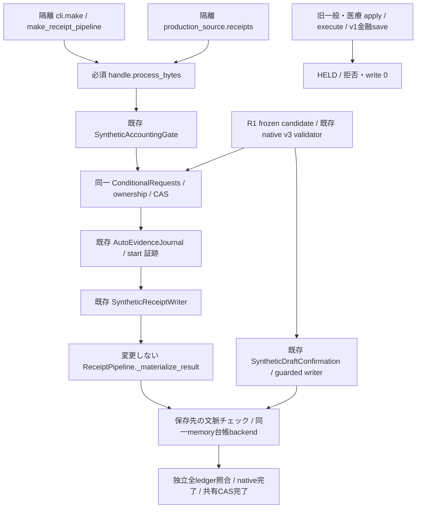

# R2-2 前半 M1–M3: 隔離 mandatory gate

作業基点は #147 `c46e694aeec3cff03e193db562b9b8064e1dbb0f`。
main の AGENTS.md、継続仕様全文（section 10 を含む）、#133–#147 の依存関係を確認。
#135/#136 の自動記帳接続、#139/#140 の旧確認validator/guarded writer、
#144–#146 の native v3/本人確定を再利用する。新DB/CAS engine/authority schema/ログイン方式は追加しない。

## 範囲と現在の状態

`staging_shadow/mandatory_receipt_gate.py` の opt-in memory composition 内だけを統制する。
既存 app、既存 staging writer/validator、auth-session、production constructor、既存workflow、
39入口一覧とそのA–E判定は不変。本番は全入口 **本番未確認・未統制** のままである。
旧workflow/固定SHA/旧hostを閉鎖した証拠ではなく、本番有効化の判断には使えない。
合成の正常動作と配備・稼働確認を混同しない。実Google/OAuth/医療情報/AIには接続しない。

## 接続図と M1–M3

- M1: `MandatoryReceiptComposition` はgateとwriterを内部で構成し、未注入やstore不一致を拒否。
  `make_receipt_pipeline` / `receipts` のfrozen routeにsource bytes/hash/mimeを照合する。
  private moduleのCLI/source入口だけをこのhandleへ接続。実production runnerの署名・既定動作は変更しない。
  元のprivate `ReceiptPipeline.process_bytes` は既存sandboxが遮断したまま。
  handleの `_materialize_result`、writer単独実行、保存先の直接CASは拒否する。
- M2: automatic evidence adapter、既存validatorとduplicate/privacy検査、ownership reader、
  shared CAS、既存writerを再利用。通常は支出、買取は既存の収入一覧へ記帳する。
  `_AutoLedger` は同じbackendを二つの既存表現に投影するだけで、別DBではない。
  R1はheaderなし完全snapshot、自動は4金融表のheader付きsnapshot。収入・既存行・数式・
  他の非金融表を保持する。ETagは同じbackendのopaque tokenを使う。
  自動用generation=0は安定した投影値でありCAS revisionとしては使わない。
  R1の `submit_r1` は同じshared object/台帳port/登録native port以外を拒否する。
- M3: 旧一般・医療確認は安全な新資格を推測せずHELD。private v1 save/直接writerを拒否。
  実appの非金融saveやR1 draft保存を削除・変更しない。旧入力・履歴・保留はそのまま。
  旧医療p1/H301は新規資格として再開しない。R1医療は既存完全手入力validatorのみ。

### 証拠と実行順

原本bytes/Drive版/native/partition、全ledgerの独立観測 → existing native preflight →
共有ownership/CAS claim → native予約・pending/consume → writer_started保存・完全read-back →
一度限りdispatch → 既存writer本体 → 全ledger独立照合 → native完了 → 共有CAS完了。
R1の非金融qualificationは既存契約に従いshared claim前に保存し、金融pending/consumeはclaim後。
自動native evidenceの `synthetic_preflight_only / native_authority=False` は実authorityではない。
本番authority発行・消費を追加したとは主張しない。

根拠は新compositionの `_Port.replace_versioned`, `_admit`, `_fresh`, `submit_auto`, `submit_r1`、
既存 `SyntheticAutoEvidenceAdapter.checkpoint/observe_boundary`、`NativeEvidenceJournal.move`、
`SyntheticReceiptWriter.execute`、`SyntheticDraftConfirmation.submit`、
`IsolatedDraftContract.consume/start/dispatch`、`_MemoryLedger._guard/_write`。
既存writer本体への到達箇所は既存sink censusの3delegateのみで増やしていない。

## 競合・旧履歴・不確定結果

- whole-sourceは全Unit/canaryと競合。incomplete partitionは既存readerがUNKNOWN。
  PDFの金融writerは接続しない。独立完全partitionのないUnitを非競合とみなさない。
- 通常/買取/R1で同じoperation identityとshared storeを使う。別requestはfenceを更新・解除しない。
  `_admit` は同一bytes hashのコピーも別source IDだけでは独立と認めない。既存relationと併用し、
  異owner・不明な古いoperationはfail-closed。
- `RetainedHistoryReader` は明示的に棚卸した旧文書をread-onlyで二重観測。
  pending/applied/UNKNOWN/不明operationを採用・移行せず保留する。
  登録R1 native v3の元legacyもチェックし、lineage marker以外のoperationは競合履歴として扱う。
  登録には既存validatorのmanifest/parent pinを要求する。pinなし外部v2/v3は採用しない。
  旧文書のraw digest/ETagも試行中固定し、途中で変われば次の保存を拒否する。
  正確な現在のqualified requestだけを自分のclaim前に除外し、別requestは除外しない。
  旧文書の所在不明はcomplete=Falseで停止する。空tupleはテストの新規fixture構築に限る。
- 開始後の失敗時にnativeをpartial/unknownへ追記する旧adapterのcleanupも、このcompositionでは拒否。
  persisted writer_started/executingを残し、UNKNOWN/PARTIALでは追加write・自動retry・fence解除をしない。
  native completeだけではCOMPLETEにせず、shared completeも必須。
- 再構築は既定read-only（`allow_new_attempts=False`）。明示的な新規fixture開始だけtrueにする。
  証拠がまだないbefore-claim crashも、再構築して推測再実行しない。
  実運用の復旧許可をこのflagで代用してはならない。
- Python objectのprivate属性は敵対コード向けsandboxではない。backend所有者がprivate参照を取り出し
  直接改変する脅威は統制外。compositionの公開入口・writer handle・保存先portでの迂回拒否を検証する。
  本番sinkのアクセス制御や旧host停止を済ませたとは扱わない。

## 検証

専用Ubuntu CIはnew / inherited static / existingを別JUnit集計する。
正常・競合・2/16並列・再送/再利用・CAS異常・crash・保存先直接アクセス・旧履歴・PDF競合・
医療/機微AI拒否を新規テストで確認し、R1/通常/買取/旧確認の既存安全回帰を別実行する。
実行件数とCI URLはPR本文の最終実行結果に記録する。収集だけの件数を実行済みと数えない。
新しい競合fixtureはv2/v3 pin前に空の対象台帳を用意し、保持済み文書を空にしてはいない。

未実施: 実Google/IAM/権限、実runnerの現在状態・実行SHA、device試験、
prod固定SHAの遮断、実drain・migration・本番切替、任意の動的call graphの完全証明。
今回のR1接続は既存v3 server candidateのcomposition API。既存one-tab UIは変更せず回帰する。
UI hostからこの新compositionを本番選択する配線はまだ実装・承認していない。

## 本番未統制の入口と残工程

全39行の根拠・A–Eは `r2-1-ingresses.json` / `r2-1-writer-audit.md` を継承。
特に銀行、PayPay、Amazon、現金等手入力、カテゴリ/台帳修正、直接SDK/DB更新、
再取込・過去分、PDF Unit/複数ページ/canary、固定SHA workflow/test_tree/auth-session bundle、
旧host/定期runnerは未改修。通常/買取/旧確認もproduction既定経路は未統制。
これらが稼働可能なままで新R1を本番有効化可能とは判定しない。

R2後半は #147 M4–M6を維持し、(1)全sinkと旧実行参照の閉鎖範囲を確定、
(2)PDF native資格とpartitionを独立調査、(3)非対象ledger writerとの排他、
(4)actual runner/固定SHA/current job/in-flightを人間の承認下でread-only確認、
(5)隔離adapterから実運用境界への最小配線を別PR、(6)drain/切替の承認、の順。
新しい金融機構を増やす前に既存gate/ConditionalRequestsを各境界で必須にする。

R3実Google接続前には、同一store・source/全ledger/native観測の実backend契約、
ETag/CAS/timeout/read-backの実証、未統制writerの実行不能性、old pending/UNKNOWNのread-only照合、
監査・原本・台帳保存、本人/CSRF/owner検証と実権限の分離が必要。

人間の別承認が必要: Google/OAuth接続・新資源・Cloud/deploy、本番constructor配線、
既存runner受付停止/job停止/schedule・固定SHA変更、drain実行、金融authority/実write、
native migration/履歴復旧、main merge、本番切替。
切替は新規受付停止とin-flight完了待ちを分け、前後の全read-backを照合。
異常時は受付/dispatch停止とread-only照会に戻す。rollbackでも旧無条件writerは復活させない。
UNKNOWN解消の推測再実行・再投入・空native初期化は禁止。今回は上記操作を実行しない。
