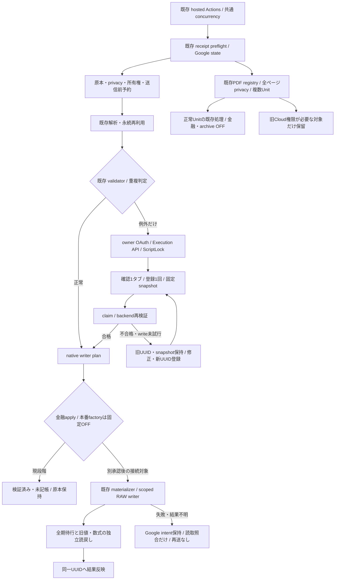

# PR #208 hosted receipt接続：実装結果と実接続条件

2026-11-26。基準 `416c6f43ba4409fec998b0fbaf787611ba1b3a70` からの後続実装。
[architecture-contract.md](architecture-contract.md) のA01～A15は不変。
**Draft・本番NO-GO・実金融write OFF**。配備・設定変更・資格発行・dispatchの承認ではない。

## 実装した実行経路

### PAT非中継の確認シート接続

`receipt_hosted.open_pipeline → open_review → OwnerReviewPort → receiptHostedBackend`
が実行経路。intake、lookup、pending、read、claim、finish、rearmを既存Execution APIと
ScriptLock下で処理する。直接Sheets PUTでlockを迂回しない。

既存authorized-user形式のowner OAuthを使用する。receiverは実効owner、固定Script/book/folder、
既存backend enabled・登録許可・STOPをコマンド及び変更前に検証する。APIアクセスは `MYSELF`。
run ID・公開GitHub情報は送信も認証利用もしない。Python RPCはredirectなし・1回だけで、
401後のRPC再実行も禁止する。OAuthの事前refreshは可能だが、資格発行・同意の代行はしない。
認証失敗・scope不足・binding変更・STOP・結果不明はfail-closed。

#206からdecoder/snapshot/receiver/1タブ/税・再評価の既存補助を選択再利用した。
Sheets.gsはsource/row/hash/ScriptLock共通部分だけを取り込み、旧PAT gateや資格保存処理は除外。
旧receiverのacceptanceは明示拒否。hosted入口は認証済みownerとGoogle側の明示的な受付設定を使う。
旧 `RECEIPT_VALIDATION_ENABLED=false` を新入口の有効化とは解釈しない。
既存PATの取得・移送・失効・削除は行っていない。

### native金融権限アダプタ

`NativeReceiptWriter.prepare/apply/reconcile` は既存materializer、PlanningDB、check_duplicates、
ScopedMaterializerDB、read_ledger/outcomeを再利用する。新しい金融grant発行器・署名鍵は作らない。
applyは既存main/SHA・hosted Linux・workflow・旧入口停止境界に加え、私的な親ProductionLedgerの
receipt pending attemptと親から渡した同一attempt、Google上の固定source/plan/claim/snapshotを要する。
各append直前にも権限・永続intent・原本・snapshotを検証し、既存カテゴリ・重複判定を実行する。
全期待会計行と全旧値・数式の読戻しが一致した場合だけ完了する。update/delete経路はない。

**本番factoryの `native_apply=False` はコード固定**。Google stateのfinancial_write_enabledもfalseを維持。
flag、登録、synthetic_complete、公開runだけでは金融権限にならない。
隔離試験だけは合成の親台帳・金融台帳・明示的な試験ON状態で同じnative applyを実行する。
本番applyへの接続変更・私的状態変更・実記帳許可は別承認。

append失敗時は全台帳を照合する。最終appendの応答だけ失われても全行一致なら閉じられるが、
部分反映・未反映・旧値変更はUNKNOWNのまま。欠けた行を補送しない。
結果表示失敗時も再記帳しない。`reconcile(plan)` は読取だけで、STOP/親pending解除や結果再送をしない。

### 例外修正・複数ページ・原本

確定した検証不合格で金融試行なしの場合だけ、旧UUID/request/snapshot/resultを変更せず、
同じcase/source/baselineに新UUIDをappendする。入力・注記は同じUI行に保持し、登録checkboxだけを更新。
重複疑い、write開始済み、成功、結果不明は再登録対象外。再設定失敗はGoogle busy/STOPを残す。
review/held/未記帳案件はbounded inbox枠から外し、登録pollingで処理するため独立正常案件を妨げない。
既存global UNKNOWN/STOPは緩和しない。

PDFは既存registry・page/Unit identity・分類・解析・validatorを維持する。
whole/旧確認との競合は当該PDFだけ保留。1ページPDFにもnative registry所有権確認を要する。
新hosted経路は `remote_proof=False` で旧Cloud Runへ接続しない。
自動分類で一般と確定しないページ・認証済みUnit確認が必要な対象は保留する。
旧Cloud権限をowner OAuth登録へ単純置換するとpurpose/Unit権限変更になるため未実施。
既存エンジン・旧authorityを削除/移植/解除しない。PDF解析前も既存Google CAS registryに
analysis_startedを保存し、runner消失・応答不明後の再AI送信を防ぐ。

hosted PDFは金融apply・archiveともOFF。基準PRのretention保護を維持し、全PDFの削除を拒否する。
1 Unit完了、processed印、synthetic結果では削除不可。通常画像も新hosted完了証拠をretentionへ
推測移植せず、証拠不明なら保持する。今回は実原本の移動・削除0件。

## 現在状態の読取り結果

2026-11-26のsnapshot。秘密値・原本内容は出力しない。設定は変更していない。

| 対象 | 確認結果 |
|---|---|
| main / validated main Variable | 両方 `fa7ac9378ef51e4a51258dd6053afe52ed0a2bb8` |
| #208開始時 | Draft、headは指定基準416c6f43、baseは上記main |
| workflow状態 | production/monthly/Unit canaryはactive。旧process-receiptsはdisabled_manually |
| schedule設定 | 全体=false、core=false、PayPay=false、銀行=true。receipt専用VariableはRepository一覧になく既定false |
| Secret存在 | SA/Gmail等の既存Secret名は存在。値・失効・実scopeは未確認 |
| 新接続設定 | GOOGLE_RECEIPT_OWNER_TOKEN_JSON Secret、RECEIPT_HOSTED_REVIEW_BINDING VariableはRepository一覧にない |
| 親Google台帳 | schema 1 / generation 1412。receipt/paypay/bank等ready。aupay_cardはpending・attemptあり |
| receipt JSON候補 | receipt-reimport-v1、旧解析10件complete。hosted namespaceなし。waitingは医療1件・受付保留5件 |
| PDF registry候補 | pdf-intake-current-v1 / generation 50。15ページ。Unitはneeds_review 10・imported 2・needs_human_completion 2 |
| Google ACL | 状態folder・上記JSONはowner 1・writer 1。メールidentity/暗号化bindingとの一致は未確認 |
| Script配備版・Properties・OAuth project/scope | 取得できず未確認。book名・更新時刻から配備SHAやSTOPを推定しない |
| 全未処理/UNKNOWN/STOP | 読取対象外、Script Properties、旧PC fence、card native内部は未確認。ゼロと報告しない |

候補stateは既存system_state folderで特定し、metadata確認後に読み、構造/件数だけを抽出した。
現行の暗号化bindingとの同一性が未確認なので、全本番の完全棚卸しとは扱わない。
既存schemaは再利用できるが、新namespaceの初期化・旧原本やcaseのowner移行は実施していない。

### main retentionリスクと最小保護措置（未実施）

mainには未統合の金融完了証拠による削除保護がまだない。
monthlyはactiveだが現在の全体schedule=falseで定期jobは止まる。
11月1日run41356390118はskipped、10月1日run36937573845はsuccess。
**手動cleanupは別経路で、未完了processedの削除リスクが残る。**
最小保護は、基準PRのmaintenance.receipt_completion_check・CLI接続・retention試験だけを
別承認の独立hotfixとしてmainへ取り込むこと。それまではmonthlyの手動cleanupを実行しない。
緊急停止が必要なら削除stepだけの一時停止を別途承認し、銀行等を止めない。今回停止・設定変更はしていない。

## A01～A15 修正後適合表

「実装」はDraft上。全体の本番適合を認定する表ではない。

| ID | 証拠・残条件 |
|---|---|
| A01 | 既存hosted Linux Actionsへ接続、architecture CIでfactory経路を検査。本番未配備 |
| A02 | 新経路にWindows/DPAPI/永続ローカルDBなし。Google復元の隔離試験あり。PC OFF未実証 |
| A03 | 98列1タブ・登録checkbox・下書きを保持。新接続のiPhone実機未検証 |
| A04 | 既存schedule/Gmailを維持。receipt/core/PayPay再開は別承認 |
| A05 | 既存解析/validator/カテゴリ/重複を再利用。実解析未実行 |
| A06 | 正常は確認Sheetを経ずnative終端へ隔離試験合格。本番write OFF |
| A07 | 不整合だけintake。医療/unknownはAIなし。未接続Unit権限対象は個別保留 |
| A08 | 1登録→再検証→native writer→読戻し→同一UUID結果の隔離E2E合格。実Google/iPhone未検証 |
| A09 | 不明原本保持。全PDF retention拒否・hosted Unit archive OFF。main保護は別途必要 |
| A10 | 既存医療完全手入力維持。医療/unknown AI禁止を既存・追加試験で確認 |
| A11 | 銀行/Payroll等と履歴は変更なし。買取票収入是正は別単位 |
| A12 | 既存Google intent/CASを再利用。新runnerでAI/write再送なしの隔離試験。実復元未検証 |
| A13 | 新receipt接続にPAT保存/送信なし。現金/カテゴリの旧PAT依存は別単位で残る |
| A14 | 新infra/鍵/許可発行器なし。新hosted PDFは旧Cloud接続拒否。無料枠/quota未実測 |
| A15 | UUID/snapshot/履歴/入力/医療/STOP/UNKNOWN保持。既存安全試験削除なし |

## 変更ファイル・再利用・省略

| ファイル | 変更理由 |
|---|---|
| app/receipt_hosted_review.py | owner OAuth単発transportと固定binding |
| apps-script/receipt-validation/Hosted.gs | 既存owner/ScriptLockでPAT不要入口、明示開始、修正登録 |
| 同Code/Sheets/Review/ReviewSetup/TaxCorrection/PolicyRecheck/manifest | #206の必要receiver/UI依存を選択再利用。旧PAT gateを除外、金融結果表示とappend-only履歴を拡張 |
| app/receipt_hosted_writer.py | 既存production権限/親台帳/materializer/scoped RAW/完全読戻しのアダプタ |
| app/receipt_hosted.py | factory接続、金融OFF、durable intent、同一案件結果、再登録、PDF所有権 |
| app/production_flow.py | 既存親attemptを子へ束縛、owner資格を他子から除外 |
| app/production_source.py | 既存PDF engineへ接続 |
| app/receipt_confirmation_production.py | 保留の枠占有防止、PDF競合拒否、hostedから旧Cloud/archiveを使わない |
| app/pdf_intake_production.py / pdf_intake_runner.py | 金融/remote authority OFFの伝達、既存Google registry送信前フェンス |
| .github/workflows/kakeibo-production.yml | 既存jobへowner設定参照だけ追加。新workflow/cronなし |
| tests/test_receipt_hosted_connection.py / test_architecture_contract.py / Script harness | 本番adapter・実receiver REST経路・再登録・障害・復元のオフライン検証 |
| 本書・既存implementation・architecture正本 | 現在の実装/未検証事項への参照更新。A01～A15本文不変 |

新workflow、30分polling、Windows trial一式、SQLite fence、DailyPermit、署名鍵、OAuth client、
Cloud、ルールエンジン、旧stackの一括取り込みは省略。writerやvalidatorの作り直しはしない。
基準CI45720758156（general4183/sensitive709/OCR）は未変更機能の背景証拠として再利用するが、
今回の接続合格証拠に流用しない。接点・故障・原本保護だけを追加試験し、既存通常CIも実行する。
対象SHA・最終CI結果はPR #208 Checksを参照。実Google/実AI/実金融の副作用0。
実配備、OAuth同一project/scope、認証失効、quota、実book数式再計算、iPhone、PC OFFは未検証。

## 実接続に必要な設定変更（すべて未実施・別承認）

1. 既存owner OAuthと同一standard Google projectを確認。必要scopeはmanifestのSheets、
   script.scriptapp、script.external_request、userinfo.email、Drive readonly。Gmail専用tokenやSAは代用不可。
   新client/大幅認証変更が必要なら当該対象を停止し理由を報告する。
2. 選択した既存Scriptへソース反映、API executableをMYSELFの固定versionに配備。
   既存book/folder/owner/Script ID/既存edit triggerを照合。承認済み合成bookの無断転用禁止。
   PropertiesのSTOP/PAT/履歴を勝手に消さない。
3. Repository Secret `GOOGLE_RECEIPT_OWNER_TOKEN_JSON` に既存資格を別承認で保存。
   今回資格の発行・取得・保存なし。値をPR/Google Properties/ログへ出さない。
4. Repository Variable `RECEIPT_HOSTED_REVIEW_BINDING`：JSONキーは
   `script_id,owner_email,spreadsheet_id,folder_id`。spreadsheet_idは確認book、folder_idはinbox。
   receiver statusと完全一致を要する。金融台帳IDは既存manifest/SPREADSHEET_IDと照合。
5. 既存Google stateの現binding/ACL/schema/旧historyを確定し、別承認でreceipt_hosted_v1を追加。
   値はschema=receipt_hosted_v1、enabled=true、financial_write_enabled=false、records/requests空dict、stopped=false。
   旧キー保持。既存STOP/UNKNOWNや旧原本のownerを初期値で上書きしない。空bootstrapもしない。
6. 別承認で既存receiptReviewRegistrationEnableとreceiptHostedStartを実行。受付ONは金融許可ではない。
7. merge/配備/validated SHA更新も別承認。金融OFFの限定E2Eを先行し、schedule設定はまだ変更しない。

## 最短の残工程・GO条件

| 段階 | 最小実施内容・GO条件 |
|---|---|
| 今回 | 実装/オフライン/通常CI/Draft更新。本番NO-GOで停止 |
| 接続限定E2E・別承認 | 必要設定だけを固定。既存独立book/合成原本、hosted PC OFF、owner RPC、1登録、native plan/結果を実証。金融OFF・AIなし・旧状態不変 |
| 実一般限定E2E・別承認 | 原本/SHA/AI有無・回数を限定。医療0、正常確認行0、例外のみ、修正登録、Google復元を実証。金融OFF |
| 金融canary・別承認 | native apply接続変更と既存privilege/stateを明示承認。1正常・1例外を完全読戻し。部分/不明は照合のみ、重複0。原本操作は別許可範囲だけ |
| 定期開始・別承認 | A01～A15、iPhone、PC OFF、原本全対象完了を受入。SHA/配備/設定/旧入口/in-flight/STOP/UNKNOWNを再確認してschedule開始 |

現行親card pendingとnative依存状態の照合がreceipt/core/PayPay再開の先行条件。再実行で解除しない。
PayPay単独成功だけではcoreの後続reconcile/auto_expense/表示更新まで成立したと扱わない。
銀行の既存独立scheduleは変更しない。

全体GOの別変更単位：現金/カテゴリPAT依存解消、買取票収入と銀行正本の整合、
旧Cloud権限が必要なPDF例外のpurpose/Unitを守るPAT不要接続、main retention保護、
未確認の権限/STOP/UNKNOWN及び実機受入。履歴を書き換えて解決しない。
